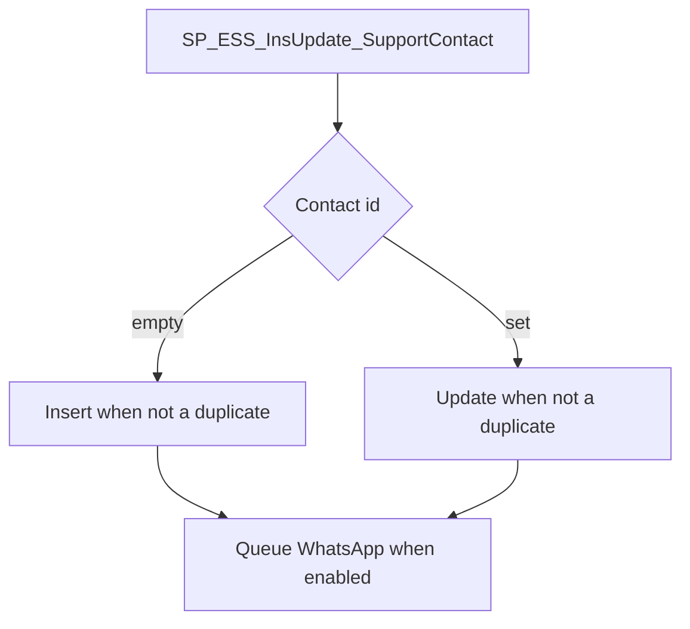

# SP_ESS_InsUpdate_SupportContact

## What it does

Inserts or updates a support contact. A null or zero contact id inserts. A positive id updates that row. External contacts are matched by name and phone. Employee contacts are matched by employee id. A duplicate returns Record Already Exists. A successful insert or update queues a WhatsApp row when the employer has an active WhatsApp client.

## Parameters

| Name | Direction | What it is for |
|---|---|---|
| `@TEmpSupportContactID` | in | Null or 0 inserts. A positive id updates that row |
| `@EmployerId` | in | Employer |
| `@BusinessUnitName` | in | Business unit label |
| `@EmployeeID` | in | Employee id, or 0 for an external contact |
| `@EmployeeName` | in | Display name |
| `@ContactNo` | in | Phone |
| `@EmailID` | in | Email |
| `@IsActive` | in | Y or N. Defaults to Y |
| `@LoginUserID` | in | User stored as created by or updated by |

## Call sequence

Calls no other procedures or functions.

## Callers

No other procedure or function calls this object.

## Nested

Calls no other procedures or functions.

## Steps

1. When the contact id is null or 0, count an existing active row and insert only when the count is 0 (`SP_ESS_InsUpdate_SupportContact.sql`).
2. When the id is positive, apply the same duplicate check against other rows and update the matching contact.
3. After a successful insert, queue SupportContactsAdded. After a successful update, queue SupportContactsUpdated. Both checks `[MSG-MESH].dbo.MessagingClientConfig` for an active WhatsApp client.
4. Return an ErrorMessage result set.

## Tables

| Table | Read or write |
|---|---|
| `dbo.TEmpSupportContact` | read and write |
| `dbo.TWhatsAppNotification` | write |
| `MSG-MESH.dbo.MessagingClientConfig` | read |

## Flow

