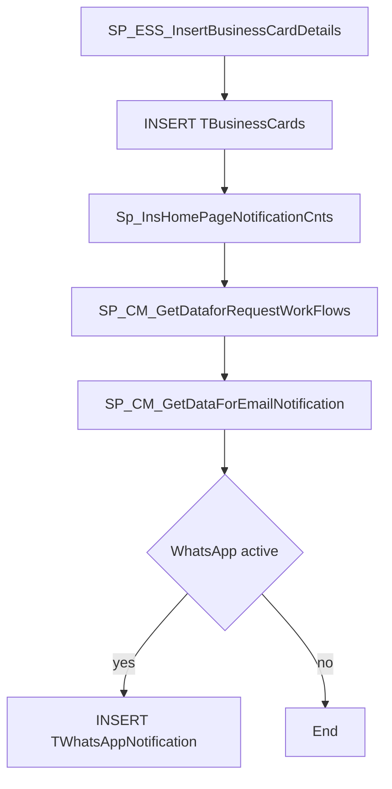

# SP_ESS_InsertBusinessCardDetails

## What it does

Creates a pending business-card request for an employee, seeds home-page notification counters, inserts workflow rows from the mapped BusinessCard workflow, queues email notification data, and optionally queues WhatsApp rows when MSG-MESH WhatsApp is active for the employer.

## Parameters

| Name | Direction | What it is for |
|---|---|---|
| `@RequestType` | in | Request type (BusinessCard) |
| `@EmployeeId` | in | Employee the card is for |
| `@Fax / @NoofCards / @ContactAddress / @OUName / @PhNumber / @Extension / @Mobile / @EMailId / @Comments` | in | Card fields |
| `@WorkflowId` | in | Mapped workflow id (0 when none) |
| `@ManagerId` | in | Manager when no workflow tree |
| `@RoutingLevels` | in | Routing levels (UI often passes 0) |
| `@CreatedBy` | in | Submitting employee |

## Call sequence

Calls nested procedures listed under Nested when present; otherwise runs inline SQL only.

## Callers

| Object | Kind |
|---|---|
| `BusinessCardDAL.AddBusinessCardDetails` | procedure |
| `ucBusinessCardRequest.ascx.cs` | application |

## Nested

- [`Sp_InsHomePageNotificationCnts`](/docs/database/hrms/Sp_InsHomePageNotificationCnts)
- [`SP_CM_GetDataforRequestWorkFlows`](/docs/database/hrms/SP_CM_GetDataforRequestWorkFlows)
- [`SP_CM_GetDataForEmailNotification`](/docs/database/hrms/SP_CM_GetDataForEmailNotification)

## Steps

1. Resolve home-page notification id and employer from the employee.
2. INSERT TBusinessCards with RequestStatus Pending; capture identity as TransId.
3. Call Sp_InsHomePageNotificationCnts for the applicant By Me count.
4. INSERT TRequestWorkflows from SP_CM_GetDataforRequestWorkFlows.
5. Resolve approvers and pending manager; notify L1 queue.
6. INSERT TEmailNotification via SP_CM_GetDataForEmailNotification.
7. When WhatsApp client config is active, INSERT TWhatsAppNotification rows for request and approval.

## Tables

| Table | Read or write |
|---|---|
| `TBusinessCards` | write |
| `TEmployee` | read |
| `TRequestWorkflows` | write |
| `TEmailNotification` | write |
| `TWhatsAppNotification` | write |
| `MSG-MESH.dbo.MessagingClientConfig` | read |

## Unresolved calls

None noted for this feature pass.

## Flow

