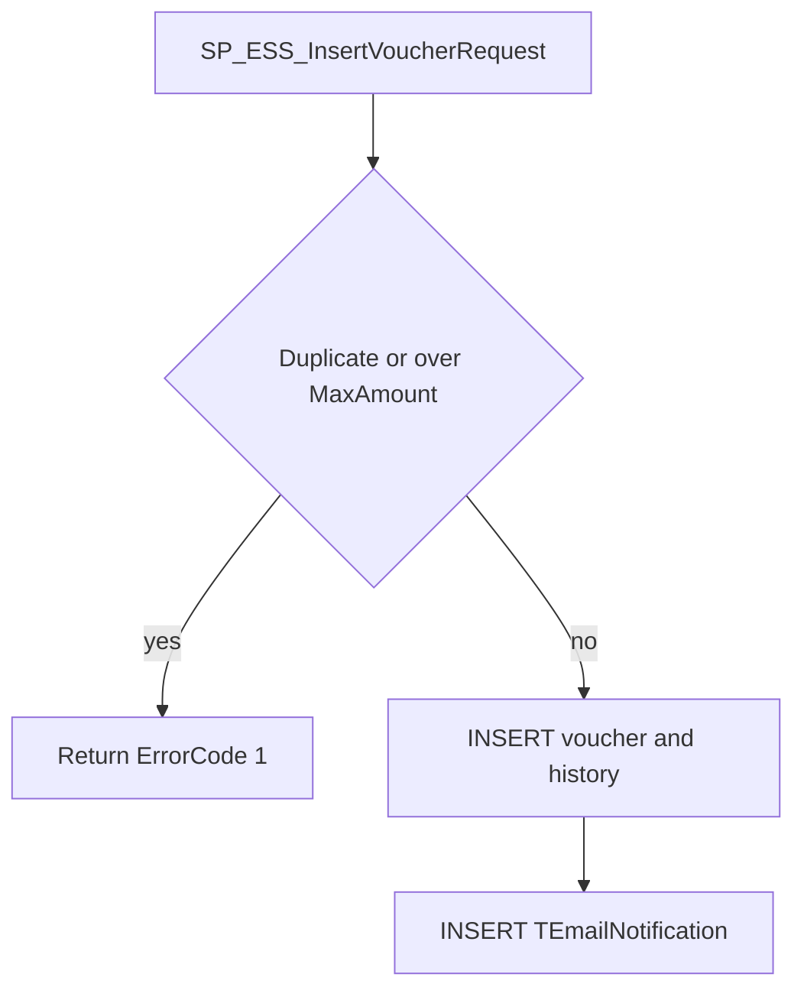

# SP_ESS_InsertVoucherRequest

## What it does

Applies an employee to an open voucher. Blocks duplicate apply for the same VoucherId and blocks amounts that exceed the voucher type MaxAmount cumulative used amount. On success inserts benefit voucher, history, email, and optional WhatsApp.

## Parameters

| Name | Direction | What it is for |
|---|---|---|
| `@VoucherId` | in | Open voucher id |
| `@EmployeeId` | in | Applicant |
| `@VoucherAmount` | in | Requested amount |
| `@RequestStatus` | in | Initial status from UI |
| `@ApplyBy` | in | Who applied |
| `@EmployerId` | in | Employer |
| `@IsConfirmed` | in | Confirmation checkbox flag |

## Call sequence

Calls nested procedures listed under Nested when present; otherwise runs inline SQL only.

## Callers

| Object | Kind |
|---|---|
| `VoucherDAL.AddVoucherRequest` | procedure |
| `ucVoucherRequest.ascx.cs` | application |

## Nested

Calls no other procedures or functions.

## Steps

1. Resolve voucher type and MaxAmount from TVoucher and TvoucherTypeMaster.
2. If already applied for this VoucherId, return ErrorCode 1.
3. If MaxAmount would be exceeded, return ErrorCode 1.
4. Otherwise INSERT TEmployeeBenefitVoucher and history; queue VoucherApplied email; optional WhatsApp VoucherSubmitted.

## Tables

| Table | Read or write |
|---|---|
| `TVoucher` | read |
| `TvoucherTypeMaster` | read |
| `TEmployeeBenefitVoucher` | read/write |
| `TEmployeeBenefitVoucherHistory` | write |
| `TEmailNotification` | write |
| `TWhatsAppNotification` | write |

## Unresolved calls

None noted for this feature pass.

## Flow

