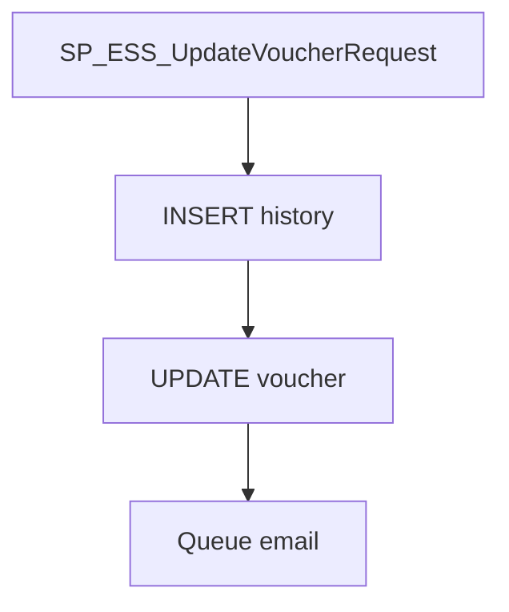

# SP_ESS_UpdateVoucherRequest

## What it does

Updates an existing employee voucher amount or status including Cancelled by Employee. Always writes a history row and queues an email template; queues WhatsApp VoucherUpdated when not cancelling and WhatsApp is enabled.

## Parameters

| Name | Direction | What it is for |
|---|---|---|
| `@EmployeeVoucherId` | in | EmpBenefitVoucherId |
| `@VoucherAmount` | in | New amount ignored on cancel |
| `@RequestStatus` | in | New status |
| `@ModifiedBy` | in | Actor |
| `@EmployerId` | in | Employer |

## Call sequence

Calls nested procedures listed under Nested when present; otherwise runs inline SQL only.

## Callers

| Object | Kind |
|---|---|
| `VoucherDAL.UpdateVoucherRequest` | procedure |

## Nested

Calls no other procedures or functions.

## Steps

1. INSERT history snapshot from current TEmployeeBenefitVoucher.
2. UPDATE amount unless cancelled and RequestStatus.
3. Queue VoucherAppliedCancellation or VoucherApplied email; optional WhatsApp on non-cancel.

## Tables

| Table | Read or write |
|---|---|
| `TEmployeeBenefitVoucher` | read/write |
| `TEmployeeBenefitVoucherHistory` | write |
| `TEmailNotification` | write |
| `TWhatsAppNotification` | write |

## Unresolved calls

None noted for this feature pass.

## Flow

