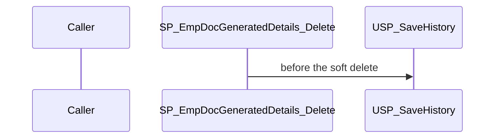
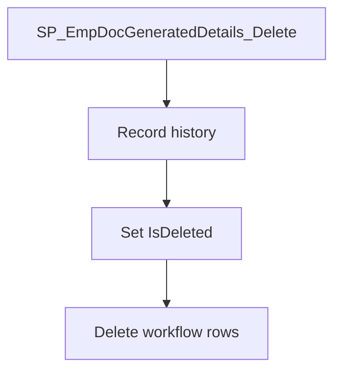

# SP_EmpDocGeneratedDetails_Delete

## What it does

Soft-deletes a generated document, records history with action D, and removes its DocumentBuilderESS workflow rows.

## Parameters

| Name | Direction | What it is for |
|---|---|---|
| `@EmployerId` | in | Employer on the generated row |
| `@DocumentGenerateId` | in | Generated document |
| `@UpdatedBy` | in | Employee who deleted |

## Call sequence

## Callers

No other procedure or function calls this object.

## Nested

| Object | Kind | When | Page |
|---|---|---|---|
| `USP_SaveHistory` | procedure | before the soft delete | No page yet |

## Steps

1. Call `USP_SaveHistory` with action D (`SP_EmpDocGeneratedDetails_Delete.sql`).
2. Set `IsDeleted` to 1 on `TEmployeeDocumentGeneratedDetails`.
3. Delete `tRequestWorkFlows` rows for DocumentBuilderESS and that generated id.

## Tables

| Table | Read or write |
|---|---|
| `dbo.TEmployeeDocumentGeneratedDetails` | write |
| `dbo.tRequestWorkFlows` | write |

## Flow

