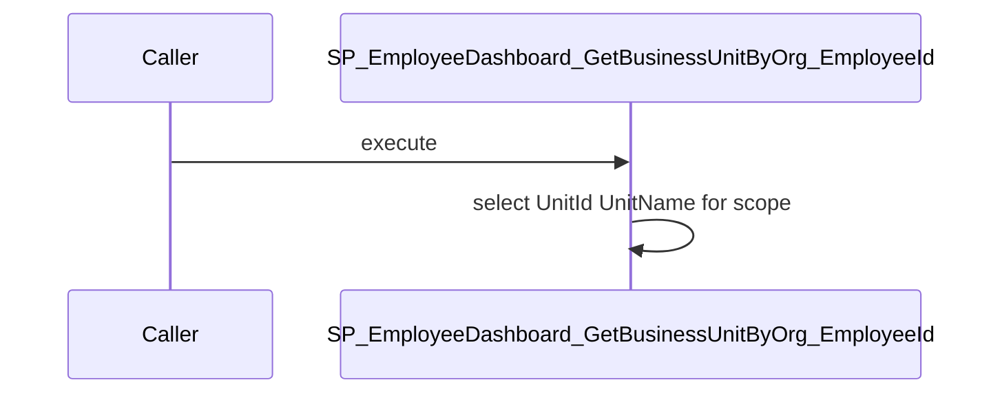
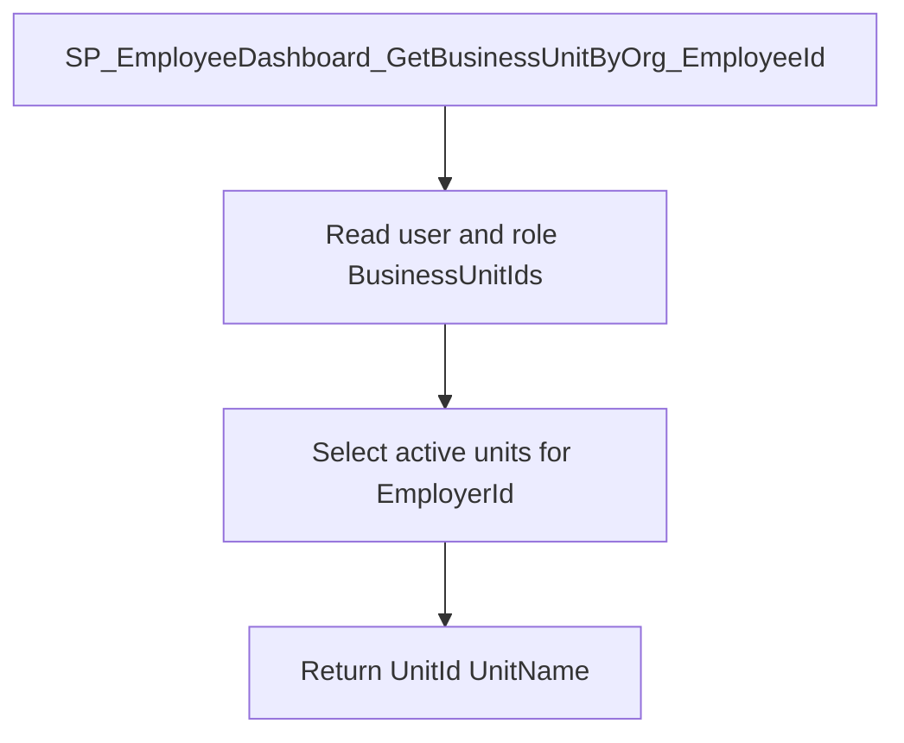

# SP_EmployeeDashboard_GetBusinessUnitByOrg_EmployeeId

## What it does

Returns active organisation units (`UnitId`, `UnitName`) the caller may use for Employee Dashboard scoping for one employer. It reads the employee's user/role business-unit mappings from `TUSerPagesMapping` and `TRolePagesMapping`. When those mappings are empty it returns all active units for `@EmployerId`; otherwise it returns only the mapped unit ids for that employer.

## Parameters

| Name | Direction | What it is for |
|---|---|---|
| `@EmployeeId` | in | Employee whose user/role BU mapping is applied |
| `@EmployerId` | in | Employer whose `TOrgHierarchyDetails` units are returned |

## Call sequence

Calls no other procedures or functions.

## Callers

| Object | Kind | Page |
|---|---|---|
| `Sp_Dashboard_CardChartInformation` | procedure | [Sp_Dashboard_CardChartInformation](/docs/database/hrms/Sp_Dashboard_CardChartInformation) |
| `Sp_EmployeeDashboard_Chart` | procedure | [Sp_EmployeeDashboard_Chart](/docs/database/hrms/Sp_EmployeeDashboard_Chart) |
| `Sp_EmployeeDashboard_Chart_DrillDown` | procedure | [Sp_EmployeeDashboard_Chart_DrillDown](/docs/database/hrms/Sp_EmployeeDashboard_Chart_DrillDown) |
| `Sp_Employeejoinleavechart` | procedure | [Sp_Employeejoinleavechart](/docs/database/hrms/Sp_Employeejoinleavechart) |
| `Sp_EmployeeDashboard_AttritionChart_DrillDown` | procedure | [Sp_EmployeeDashboard_AttritionChart_DrillDown](/docs/database/hrms/Sp_EmployeeDashboard_AttritionChart_DrillDown) |
| `Sp_EmployeeDashboard_Chart_GenerateAdditionalFilterValues` | procedure | [Sp_EmployeeDashboard_Chart_GenerateAdditionalFilterValues](/docs/database/hrms/Sp_EmployeeDashboard_Chart_GenerateAdditionalFilterValues) |
| `EmployeeRepository.getBusinessUnits` | app | [Employee Dashboard](/docs/guides/employee-management/employee-dashboard) (API available; UI unused) |

Other management/leave dashboard procedures also EXEC it; those app pages are not listed here.

## Nested

Calls no other procedures or functions.

## Steps

From `HRMS-DATABASE/HRMS/STOREPROCEDURE/SP_EmployeeDashboard_GetBusinessUnitByOrg_EmployeeId.sql`:

1. Resolve role, employer, and global-access employer list from `TUsers` / `TUserEmployee`.
2. Read `BusinessUnitIds` from `TUSerPagesMapping` and append `TRolePagesMapping` for that role and employer.
3. SELECT active `TOrgHierarchyDetails` units for `@EmployerId`, either all units when the mapping is empty or only mapped unit ids.
4. Order by `UnitName` and return the result set.

## Tables

| Table | Read or write |
|---|---|
| `dbo.TUsers` | read |
| `dbo.TUserEmployee` | read |
| `dbo.TUSerPagesMapping` | read |
| `dbo.TRolePagesMapping` | read |
| `dbo.TOrgHierarchyDetails` | read |
| `dbo.TemployerDetails` | read |

## Unresolved calls

None.

## Flow

