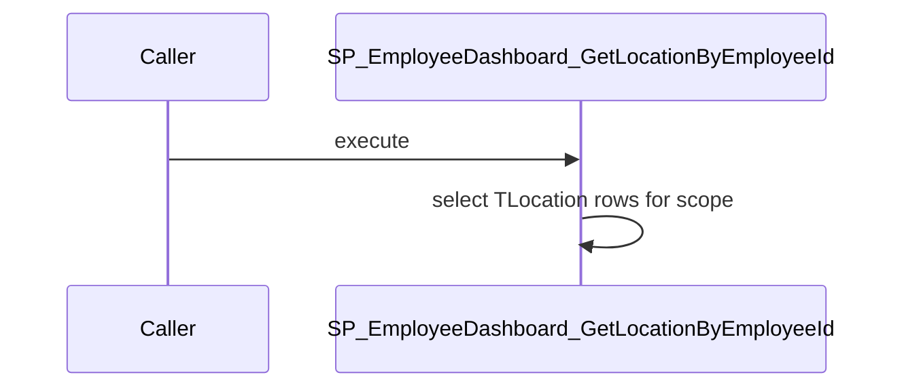
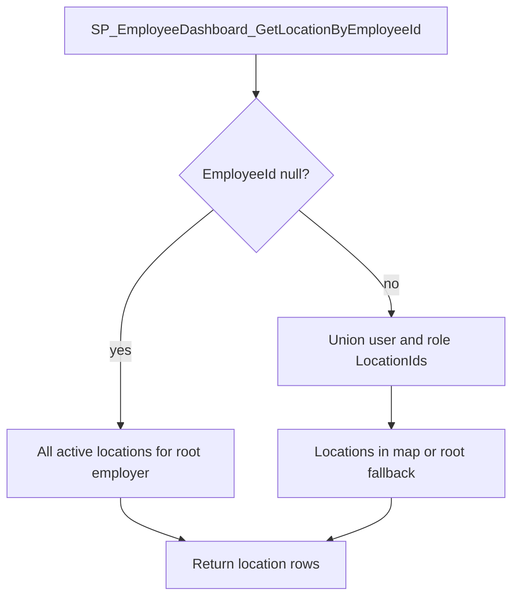

# SP_EmployeeDashboard_GetLocationByEmployeeId

## What it does

Returns active locations the caller may use for Employee Dashboard scoping, without embedding the employer name in the location label. When `@EmployeeId` is null it returns all active locations under the employer's root employer. When `@EmployeeId` is set it unions location ids from `TUSerPagesMapping` and `TRolePagesMapping` for that user's role; empty mappings fall back to the root-employer location set.

## Parameters

| Name | Direction | What it is for |
|---|---|---|
| `@EmployeeId` | in | Employee whose user/role location mapping is applied; null means employer-wide active locations |
| `@EmployerId` | in | Employer used to resolve root employer and mapping rows |

## Call sequence

Calls no other procedures or functions.

## Callers

| Object | Kind | Page |
|---|---|---|
| `Sp_Dashboard_CardChartInformation` | procedure | [Sp_Dashboard_CardChartInformation](/docs/database/hrms/Sp_Dashboard_CardChartInformation) |
| `Sp_EmployeeDashboard_Chart` | procedure | [Sp_EmployeeDashboard_Chart](/docs/database/hrms/Sp_EmployeeDashboard_Chart) |
| `Sp_EmployeeDashboard_Chart_DrillDown` | procedure | [Sp_EmployeeDashboard_Chart_DrillDown](/docs/database/hrms/Sp_EmployeeDashboard_Chart_DrillDown) |
| `Sp_Employeejoinleavechart` | procedure | [Sp_Employeejoinleavechart](/docs/database/hrms/Sp_Employeejoinleavechart) |
| `Sp_EmployeeDashboard_AttritionChart_DrillDown` | procedure | [Sp_EmployeeDashboard_AttritionChart_DrillDown](/docs/database/hrms/Sp_EmployeeDashboard_AttritionChart_DrillDown) |
| `Sp_EmployeeDashboard_Chart_GenerateAdditionalFilterValues` | procedure | [Sp_EmployeeDashboard_Chart_GenerateAdditionalFilterValues](/docs/database/hrms/Sp_EmployeeDashboard_Chart_GenerateAdditionalFilterValues) |
| `EmployeeRepository.getLocations` | app | [Employee Dashboard](/docs/guides/employee-management/employee-dashboard) (API available; UI unused) |

Other management/leave dashboard procedures also EXEC it; those app pages are not listed here.

## Nested

Calls no other procedures or functions.

## Steps

From `HRMS-DATABASE/HRMS/STOREPROCEDURE/SP_EmployeeDashboard_GetLocationByEmployeeId.sql`:

1. If `@EmployeeId` is null, resolve `@lv_RootEmployerId` from `tEmployerDetails` and SELECT active `TLocation` rows for that root, with country name.
2. Else resolve the user's role and employer from `TUsers` / `TUserEmployee`, read `LocationIds` from `TUSerPagesMapping` and append `TRolePagesMapping`, then SELECT active locations that match the split ids or the root-employer fallback.
3. Order by `LocationName` and return the result set.

## Tables

| Table | Read or write |
|---|---|
| `dbo.tEmployerDetails` | read |
| `dbo.TLocation` | read |
| `dbo.TCOUNTRY` | read |
| `dbo.TUsers` | read |
| `dbo.TUserEmployee` | read |
| `dbo.TUSerPagesMapping` | read |
| `dbo.TRolePagesMapping` | read |

## Unresolved calls

None.

## Flow

