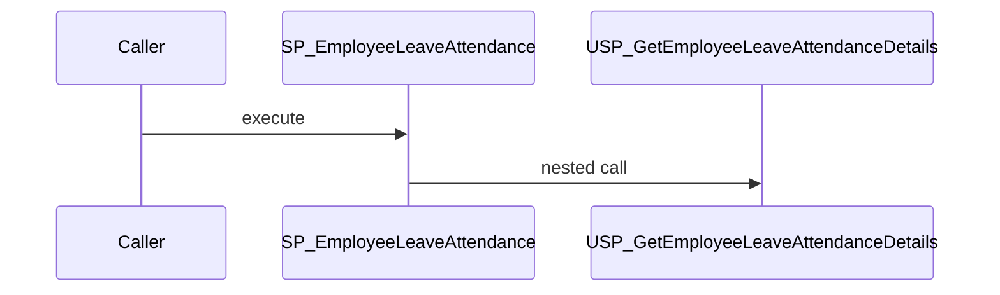
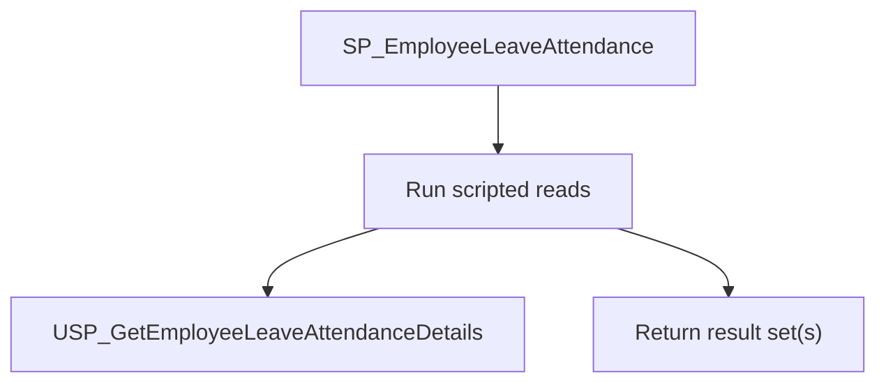

# SP_EmployeeLeaveAttendance

## What it does

Yearly leave/attendance detail used when My Dashboard calendar refreshes by year.

## Parameters

| Name | Direction | What it is for |
|---|---|---|
| `@EmployeeID` | in | `INT` |
| `@Year` | in | `INT` |

## Call sequence

## Callers

No other procedure or function calls this object. Node `leaveDashboardDAL.GetEmployeeLeaveAttendance` executes it.

## Nested

| Object | Kind | When | Page |
|---|---|---|---|
| `USP_GetEmployeeLeaveAttendanceDetails` | procedure | when reached in script | [USP_GetEmployeeLeaveAttendanceDetails](/docs/database/hrms/USP_GetEmployeeLeaveAttendanceDetails) |

## Steps

1. In `HRMS-DATABASE/HRMS/STOREPROCEDURE/SP_EmployeeLeaveAttendance.sql`, accept the declared parameters and set `NOCOUNT` / read-uncommitted as scripted.
2. Build filter / reportee temp sets when the script calls nested helpers.
3. Aggregate leave/attendance (or tab ACL) rows and return the chart or card result set(s).

## Tables

| Table | Read or write |
|---|---|
| `dbo.CTE` | read |
| `dbo.TDailyRegisterNew` | read |
| `dbo.Tleaverequestdays` | read |

## Flow

