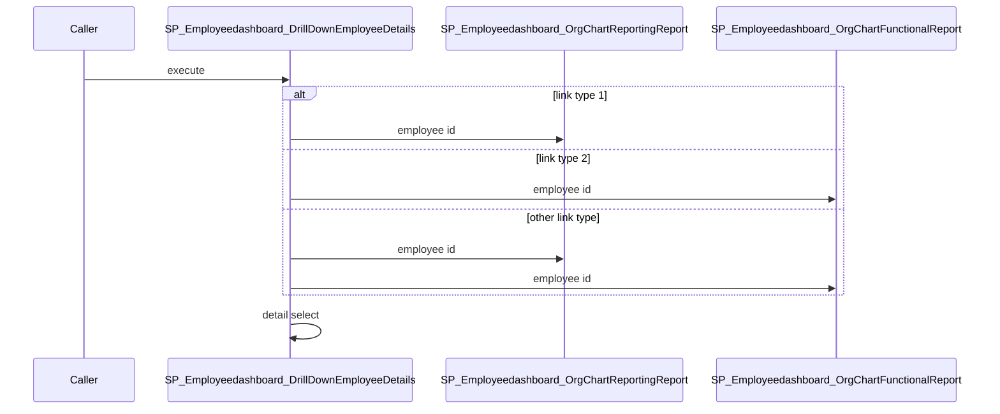
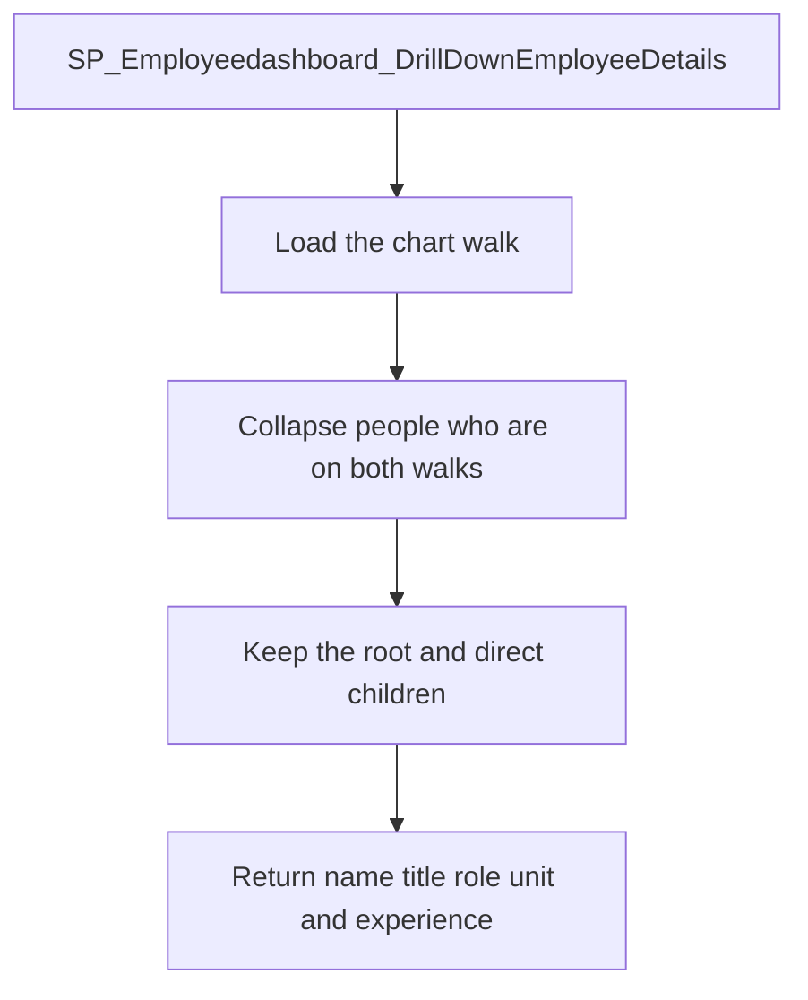

# SP_Employeedashboard_DrillDownEmployeeDetails

## What it does

Returns a detail row for the selected employee and for people whose chart parent is that employee. The tree is loaded with the same link-type split as the chart. People who appear in both walks lose the reporting copy and keep `linkType` `combined`. The inventory script begins with `USE [HRM-CL-Prod]`.

View Organization Chart calls this when the user double-clicks an employee node or a designation node. The client maps Reporting to 1, Functional and Designation to 2, and Combined Dual-Reporting to 0.

## Parameters

| Name | Direction | What it is for |
|---|---|---|
| `@EmployeeID` | in | Person who was double-clicked, and the root passed to the walks. `varchar(max)`, default null |
| `@LinkType` | in | 1 reporting, 2 functional, anything else both walks then trim to two levels. Default 0 |

## Call sequence

The nested walks open and close encryption keys before this procedure's own `Fn_GetEmployeeName` calls. That function no longer decrypts, so those names do not need the keys to stay open.

## Callers

| Object | Kind | Page |
|---|---|---|
| `dashBoardDAL.GetOrganizationChartEmployeeDetailDrillDown` | app | [View Organization Chart](/docs/guides/admin-configuration/view-organization-chart) |

No other procedure in `STOREPROCEDURE/` executes it.

## Nested

| Object | Kind | When | Page |
|---|---|---|---|
| `SP_Employeedashboard_OrgChartReportingReport` | procedure | Link type 1, and the else branch | [SP_Employeedashboard_OrgChartReportingReport](/docs/database/hrms/SP_Employeedashboard_OrgChartReportingReport) |
| `SP_Employeedashboard_OrgChartFunctionalReport` | procedure | Link type 2, and the else branch | [SP_Employeedashboard_OrgChartFunctionalReport](/docs/database/hrms/SP_Employeedashboard_OrgChartFunctionalReport) |
| `Fn_GetEmployeeName` | function | Employee name, functional-manager name, and reporting-manager name | [Fn_GetEmployeeName](/docs/database/hrms/Fn_GetEmployeeName) |

## Steps

In `HRMS-DATABASE/HRMS/STOREPROCEDURE/SP_Employeedashboard_DrillDownEmployeeDetails.sql`:

1. Set `NOCOUNT ON`, `READ UNCOMMITTED`, and low deadlock priority.
2. Load `#Output` from the reporting walk, the functional walk, or both. On the both path, delete rows with `level` greater than 2.
3. Put ids that occur more than once into `#TempId`. Delete the `reporting` row for those ids and set the remaining row's `linkType` to `combined`.
4. Copy into `#Output1` the rows whose `parentId` is `@EmployeeID` or whose `level` is 1.
5. `reportingId` is `parentId` when `linkType` is `reporting`, otherwise `TORGChart.ReportsTo`. `functionalId` is `parentId` when `linkType` is `functional`, otherwise `TEmployeeInfo.FunctionalManager`. Those two id columns are not in the final select list.
6. Join `TEmployeeInfo` and `TEmployerDetails` and return one grouped row per employee and link type.
7. Columns include employee id, employment number, name, designation from `TTitle`, role from `TEmployeeRoleMaster`, business unit from `TOrgHierarchyDetails`, date of joining, employment type from `TMEmploymentTypes`, `TEmployee.cellnumber`, functional-manager name, reporting-manager name from `TORGChart.ReportsTo`, base location, work location from `TEmployeeInfo.worklocation`, company experience, total experience, skill category from `TCategory`, `linkType`, `level`, and an adjusted `parentId`.
8. `Domain` is the literal string `NULL`.
9. Company experience is months from date of joining to today, or to last working / effective date when `TEmployerDetails.IsActive` is not 1, plus `SameOrgPreExp`, split into years and months. Total experience adds `PreviousExperience`.
10. The returned `parentId` is null when the stored parent is the employee or the requested employee. It is 1 when the stored parent is -1. Otherwise it is the stored parent.
11. Drop `#TempId`, `#Output`, and `#Output1`.

## Tables

| Table | Read or write |
|---|---|
| `#Output` | write |
| `#TempId` | write |
| `#Output1` | write |
| `dbo.TORGChart` | read |
| `dbo.TEmployeeInfo` | read |
| `dbo.TEmployerDetails` | read |
| `dbo.TEmployee` | read |
| `dbo.TTitle` | read |
| `dbo.TEmployeeRoleMaster` | read |
| `dbo.TOrgHierarchyDetails` | read |
| `dbo.TMEmploymentTypes` | read |
| `dbo.TLocation` | read |
| `dbo.TCategory` | read |

## Flow

