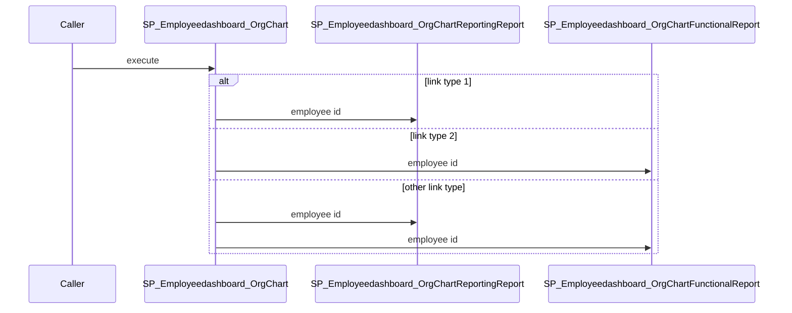
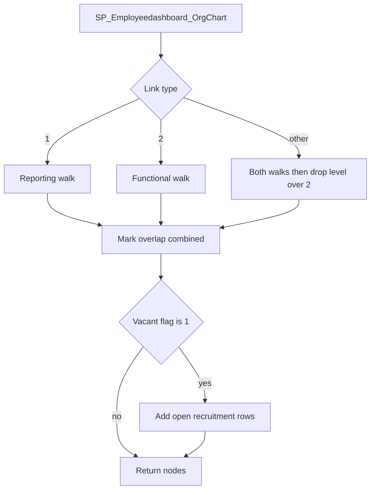

# SP_Employeedashboard_OrgChart

## What it does

Builds the reporting, functional, or combined organization chart for one employee. Link type 1 runs the reporting walk. Link type 2 runs the functional walk. Any other value, including the combined chart's 0, runs both walks and then deletes rows deeper than level 2.

A person who is in both walks is marked `combined` on the reporting row, and the functional copy is deleted. Level 1 `parentId` is set to null so the selected employee is the root. When vacant seats are requested, open recruitment requests are added under the hiring manager.

The header comment names `SP_OrgChart`. That procedure is not executed. The inventory script begins with `USE [HRM-CL-Prod]`.

## Parameters

| Name | Direction | What it is for |
|---|---|---|
| `@EmployeeID` | in | Chart root. `varchar(max)`, default null. The walks declare an int |
| `@LinkType` | in | 1 reporting, 2 functional, anything else both walks then trim to two levels. Default 0 |
| `@IsVacantVisible` | in | 1 adds vacant recruitment rows. Default 1. The chart sends 0 or 1 from the switch |

## Call sequence

## Callers

| Object | Kind | Page |
|---|---|---|
| `dashBoardDAL.GetOrganizationChartByReportType` | app | [View Organization Chart](/docs/guides/admin-configuration/view-organization-chart) |

No other procedure in `STOREPROCEDURE/` executes it. The usage comments in this file are examples, not callers.

## Nested

| Object | Kind | When | Page |
|---|---|---|---|
| `SP_Employeedashboard_OrgChartReportingReport` | procedure | Link type 1, and the else branch | [SP_Employeedashboard_OrgChartReportingReport](/docs/database/hrms/SP_Employeedashboard_OrgChartReportingReport) |
| `SP_Employeedashboard_OrgChartFunctionalReport` | procedure | Link type 2, and the else branch | [SP_Employeedashboard_OrgChartFunctionalReport](/docs/database/hrms/SP_Employeedashboard_OrgChartFunctionalReport) |

## Steps

In `HRMS-DATABASE/HRMS/STOREPROCEDURE/SP_Employeedashboard_OrgChart.sql`:

1. Set `NOCOUNT ON`, `READ UNCOMMITTED`, and low deadlock priority. Create `#Output`.
2. Insert the reporting walk, the functional walk, or both, as the link type says. On the both path, delete `#Output` rows with `level` greater than 2.
3. Set `linkType` to `combined` on reporting rows whose id also has a functional row. Delete the functional row for those ids.
4. Set `parentId` to null where `level` is 1.
5. Copy into `#Output1` and set `numberOfChildren` to the count of `#Output` children with a non-null level. `status` is the text `NULL`.
6. When `@IsVacantVisible` is 1, insert distinct `TRRSDetails` rows with `RrsStatus` in `Inprocess`, `Approved`, or `OnHold`.
7. Vacant `id` is `RRS_` plus `rrsid`. `parentId` is `HiringMGR`. `name` is `RRSTitle`. `designation` is `TTitle.Title` for `Designationid`. `type` is `vacant`. `linkType` is `rrs`. `numberOfChildren` is `NoOfPositions`. `status` is `RrsStatus`. `level` is null.
8. For link type 0, the hiring manager must be a level-1 id. For link types 1 and 2, the hiring manager must be any id already in `#Output1`.
9. Location is `TRRSDetails.JobLocation` unless `TCustomerSettings.IsManualApproval` is not 0, in which case it is `TRRSLocationPositions.JobLocation`. `project` is the business-unit name.
10. Return `#Output1` ordered by `id`, then drop both temp tables.

## Tables

| Table | Read or write |
|---|---|
| `#Output` | write |
| `#Output1` | write |
| `dbo.TRRSDetails` | read |
| `dbo.TEmployerDetails` | read |
| `dbo.TCustomerSettings` | read |
| `dbo.TRRSLocationPositions` | read |
| `dbo.TOrgHierarchyDetails` | read |
| `dbo.TTitle` | read |
| `dbo.TLocation` | read |

The walks read `TORGChart`, `TEmployee`, `TEmployeeInfo`, and the lookup tables listed on their own pages.

## Unresolved calls

The header says `EXECUTE dbo.[SP_OrgChart]`. That text is a comment. This procedure does not execute `SP_OrgChart`.

## Flow

