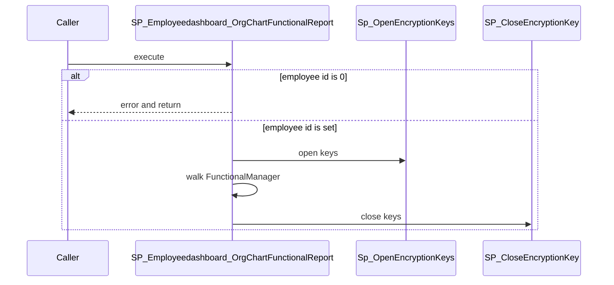
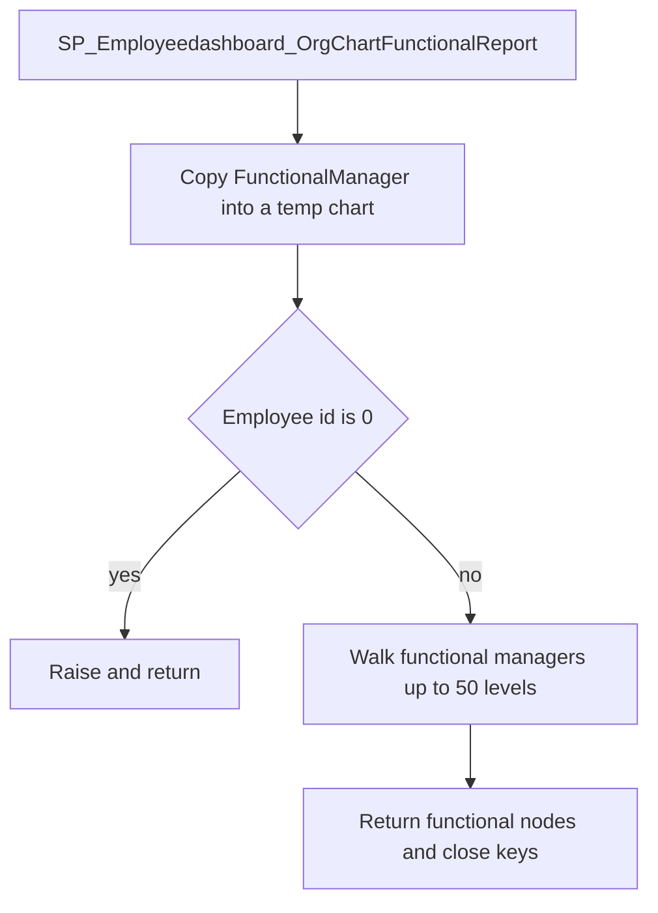

# SP_Employeedashboard_OrgChartFunctionalReport

## What it does

Walks down from one active employee through functional managers and returns each person as a chart node with `linkType` `functional`. The parent link is `TEmployeeInfo.FunctionalManager`, copied into `#TORGChartTemp.ReportsTo` for every employee-info row before the walk. The shape of the result matches the reporting walk. The inventory script begins with `USE [HRM-CL-Prod]`.

View Organization Chart does not call this procedure itself. The reporting, designation, and drill-down procedures do. Designation mode always reaches this walk because the client sends link type 2.

## Parameters

| Name | Direction | What it is for |
|---|---|---|
| `@EmployeeID` | in | Root of the walk. Default 0, which raises `Please select employee Id.` and returns |

## Call sequence

## Callers

| Object | Kind | Page |
|---|---|---|
| `SP_Employeedashboard_OrgChart` | procedure | [SP_Employeedashboard_OrgChart](/docs/database/hrms/SP_Employeedashboard_OrgChart) |
| `SP_Employeedashboard_OrgChartbyDesignationReport` | procedure | [SP_Employeedashboard_OrgChartbyDesignationReport](/docs/database/hrms/SP_Employeedashboard_OrgChartbyDesignationReport) |
| `SP_Employeedashboard_DrillDownEmployeeDetails` | procedure | [SP_Employeedashboard_DrillDownEmployeeDetails](/docs/database/hrms/SP_Employeedashboard_DrillDownEmployeeDetails) |

No application file executes this name directly.

## Nested

| Object | Kind | When | Page |
|---|---|---|---|
| `Sp_OpenEncryptionKeys` | procedure | After the zero-id check | [Sp_OpenEncryptionKeys](/docs/database/hrms/Sp_OpenEncryptionKeys) |
| `Fn_GetEmployeeName` | function | Node `name` | [Fn_GetEmployeeName](/docs/database/hrms/Fn_GetEmployeeName) |
| `SP_CloseEncryptionKey` | procedure | After the result select | [SP_CloseEncryptionKey](/docs/database/hrms/SP_CloseEncryptionKey) |

`FN_LocationBU_GetAllActiveInActive_EmployeeDetails` appears only in comments.

## Steps

In `HRMS-DATABASE/HRMS/STOREPROCEDURE/SP_Employeedashboard_OrgChartFunctionalReport.sql`:

1. Set `NOCOUNT ON`, `READ UNCOMMITTED`, and low deadlock priority.
2. Fill `#TORGChartTemp` with every `TEmployeeInfo.EmployeeId` and `FunctionalManager`.
3. When `@EmployeeID` is 0, raise and return. The temp fill has already run. Keys are not opened.
4. Execute `Sp_OpenEncryptionKeys`.
5. Insert the employee into `#FindRoot` at level 1 when `TEmployee.IsActive = 'Y'`.
6. Loop the same way as the reporting walk, using `#TORGChartTemp.ReportsTo` (the functional manager) as the parent. Skip a row whose manager id equals the employee id. Stop after a level that adds nobody or when level exceeds 50.
7. Return the same columns as the reporting walk, with `linkType` `functional`.
8. `parentId` uses the same -1 and self-or-root rules, applied to the functional-manager value stored as `ReportsTo`.
9. Designation, location, department, and project are read the same way as the reporting walk (`TTitle`, `TLocation`, `TOrgHierarchyDetails`, `TEmployeeBudgetSourceDetails` / `TProject`).
10. Drop `#FindRoot` and execute `SP_CloseEncryptionKey`. `#TORGChartTemp` is not dropped in the script.

## Tables

| Table | Read or write |
|---|---|
| `dbo.TEmployeeInfo` | read |
| `dbo.TEmployee` | read |
| `dbo.TEmployerDetails` | read |
| `dbo.TTitle` | read |
| `dbo.TLocation` | read |
| `dbo.TOrgHierarchyDetails` | read |
| `dbo.TEmployeeBudgetSourceDetails` | read |
| `dbo.TProject` | read |
| `#TORGChartTemp` | write |
| `#FindRoot` | write |

## Unresolved calls

`FN_LocationBU_GetAllActiveInActive_EmployeeDetails` is commented out and is not executed.

## Flow

