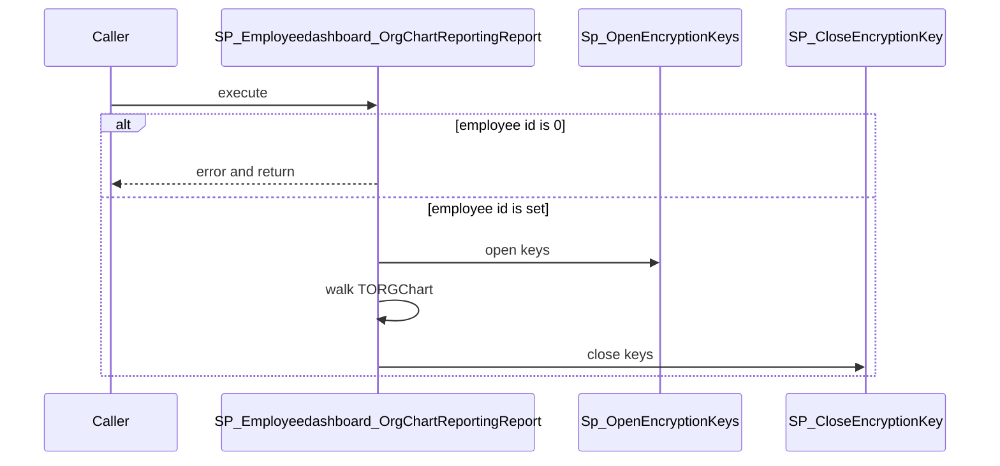
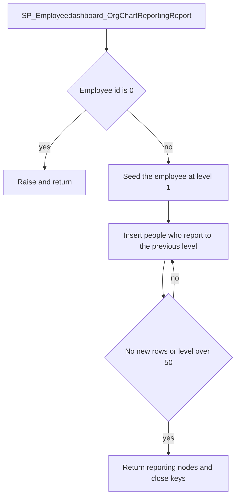

# SP_Employeedashboard_OrgChartReportingReport

## What it does

Walks down from one active employee through `TORGChart.ReportsTo` and returns each person as a chart node with `linkType` `reporting`. The selected employee is level 1. The walk stops at 50 levels or when a level adds no one. The inventory script begins with `USE [HRM-CL-Prod]`.

View Organization Chart does not call this procedure itself. The reporting, designation, and drill-down procedures do.

## Parameters

| Name | Direction | What it is for |
|---|---|---|
| `@EmployeeID` | in | Root of the walk. `0` raises `Please select employee Id.` and returns |

## Call sequence

## Callers

| Object | Kind | Page |
|---|---|---|
| `SP_Employeedashboard_OrgChart` | procedure | [SP_Employeedashboard_OrgChart](/docs/database/hrms/SP_Employeedashboard_OrgChart) |
| `SP_Employeedashboard_OrgChartbyDesignationReport` | procedure | [SP_Employeedashboard_OrgChartbyDesignationReport](/docs/database/hrms/SP_Employeedashboard_OrgChartbyDesignationReport) |
| `SP_Employeedashboard_DrillDownEmployeeDetails` | procedure | [SP_Employeedashboard_DrillDownEmployeeDetails](/docs/database/hrms/SP_Employeedashboard_DrillDownEmployeeDetails) |

No application file executes this name directly.

## Nested

| Object | Kind | When | Page |
|---|---|---|---|
| `Sp_OpenEncryptionKeys` | procedure | After the zero-id check | [Sp_OpenEncryptionKeys](/docs/database/hrms/Sp_OpenEncryptionKeys) |
| `Fn_GetEmployeeName` | function | Node `name` | [Fn_GetEmployeeName](/docs/database/hrms/Fn_GetEmployeeName) |
| `SP_CloseEncryptionKey` | procedure | After the result select | [SP_CloseEncryptionKey](/docs/database/hrms/SP_CloseEncryptionKey) |

`FN_LocationBU_GetAllActiveInActive_EmployeeDetails` appears only in comments.

## Steps

In `HRMS-DATABASE/HRMS/STOREPROCEDURE/SP_Employeedashboard_OrgChartReportingReport.sql`:

1. Set `NOCOUNT ON`, `READ UNCOMMITTED`, and low deadlock priority.
2. When `@EmployeeID` is 0, raise and return before keys are opened.
3. Execute `Sp_OpenEncryptionKeys`.
4. Insert the employee into `#FindRoot` at level 1 from `TORGChart`, `TEmployee` (`IsActive = 'Y'`), `TEmployeeInfo`, and `TEmployerDetails`.
5. Loop. Each pass inserts employees whose `TORGChart.ReportsTo` is someone inserted at the previous level, who are active, and whose `ReportsTo` is not their own id. Stop when the insert adds no row or level exceeds 50.
6. The loop joins `TEmployeeInfo` on the parent already in `#FindRoot` (`C.EmployeeId`). The final select joins `TEmployeeInfo` again on the child, so returned employment number, title, location, and department are the child's.
7. Return `id`, `EmploymentNumber`, `parentId`, `name`, `designation`, `type` `employee`, `location`, `project`, `linkType` `reporting`, `department`, and the minimum `level`.
8. `parentId` is 1 when `ReportsTo` is -1. It is `ReportsTo` when `ReportsTo` equals the employee id or the row is the requested employee. Otherwise it is `ReportsTo`.
9. `designation` is `TTitle.Title` for `TEmployeeInfo.Title`. `location` is `TLocation.LocationName` for `LocationId` and the same employer. `department` is `TOrgHierarchyDetails.UnitName` for `BusinessUnitId`. `project` is a comma-separated list of non-deleted `TProject.ProjectName` from `TEmployeeBudgetSourceDetails`.
10. Drop `#FindRoot` and execute `SP_CloseEncryptionKey`.

## Tables

| Table | Read or write |
|---|---|
| `dbo.TORGChart` | read |
| `dbo.TEmployee` | read |
| `dbo.TEmployeeInfo` | read |
| `dbo.TEmployerDetails` | read |
| `dbo.TTitle` | read |
| `dbo.TLocation` | read |
| `dbo.TOrgHierarchyDetails` | read |
| `dbo.TEmployeeBudgetSourceDetails` | read |
| `dbo.TProject` | read |
| `#FindRoot` | write |

## Unresolved calls

`FN_LocationBU_GetAllActiveInActive_EmployeeDetails` is commented out and is not executed.

## Flow

