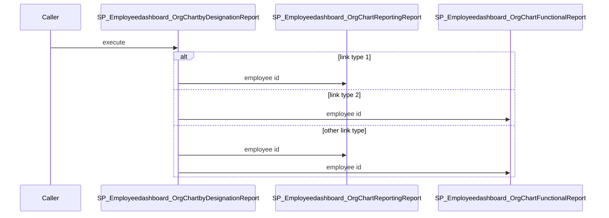
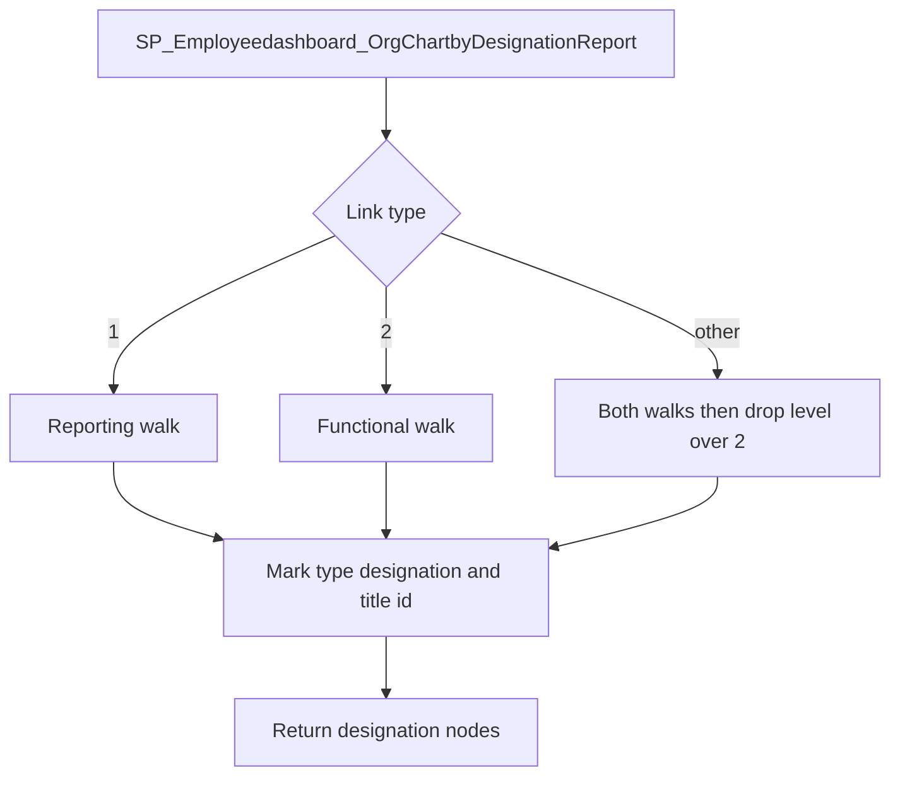

# SP_Employeedashboard_OrgChartbyDesignationReport

## What it does

Builds the same employee tree as `SP_Employeedashboard_OrgChart`, then returns every node with `type` `designation` and a `designationId`. The id is `TEmployeeInfo.Title` for that employee, which is the foreign key to `TTitle`, not `TEmployeeInfo.DesignationId`.

View Organization Chart always calls this with link type 2, so only the functional walk runs. The browser groups nodes that share `designationId`. The vacant-seat insert is commented out. The inventory script begins with `USE [HRM-CL-Prod]`.

## Parameters

| Name | Direction | What it is for |
|---|---|---|
| `@EmployeeID` | in | Chart root. `varchar(max)`, default null |
| `@LinkType` | in | 1 reporting walk, 2 functional walk, anything else both walks then trim to two levels. Default 0. This screen sends 2 |

## Call sequence

## Callers

| Object | Kind | Page |
|---|---|---|
| `dashBoardDAL.GetOrganizationChartByDesignation` | app | [View Organization Chart](/docs/guides/admin-configuration/view-organization-chart) |

No other procedure in `STOREPROCEDURE/` executes it.

## Nested

| Object | Kind | When | Page |
|---|---|---|---|
| `SP_Employeedashboard_OrgChartReportingReport` | procedure | Link type 1, and the else branch | [SP_Employeedashboard_OrgChartReportingReport](/docs/database/hrms/SP_Employeedashboard_OrgChartReportingReport) |
| `SP_Employeedashboard_OrgChartFunctionalReport` | procedure | Link type 2, and the else branch | [SP_Employeedashboard_OrgChartFunctionalReport](/docs/database/hrms/SP_Employeedashboard_OrgChartFunctionalReport) |

## Steps

In `HRMS-DATABASE/HRMS/STOREPROCEDURE/SP_Employeedashboard_OrgChartbyDesignationReport.sql`:

1. Set `NOCOUNT ON`, `READ UNCOMMITTED`, and low deadlock priority. Create `#Output`.
2. Insert the reporting walk, the functional walk, or both, using the same link-type split as `SP_Employeedashboard_OrgChart`. On the both path, delete rows with `level` greater than 2.
3. Mark overlap as `combined` and delete the extra functional row. Set level-1 `parentId` to null.
4. Copy into `#Output1`. `designationId` is `TEmployeeInfo.Title` for the node id. `type` is the literal `designation` for every row. `numberOfChildren` counts children in `#Output` with a non-null level.
5. The recruitment-request insert that follows is commented out, so no vacant rows are returned.
6. Return `id`, `EmploymentNumber`, `parentId`, `name`, `designation`, `designationId`, `type`, `linkType`, `department`, and `numberOfChildren`, ordered by `id`.

## Tables

| Table | Read or write |
|---|---|
| `#Output` | write |
| `#Output1` | write |
| `dbo.TEmployeeInfo` | read |

The walks read `TORGChart` or `TEmployeeInfo.FunctionalManager` and the lookup tables on their own pages. Commented vacant SQL names `TRRSDetails`, `TEmployerDetails`, `TCustomerSettings`, `TRRSLocationPositions`, `TOrgHierarchyDetails`, `TTitle`, and `TLocation` and does not run.

## Unresolved calls

`SP_OrgChart` is named in a comment and is not executed. The vacant `INSERT` is commented out.

## Flow

