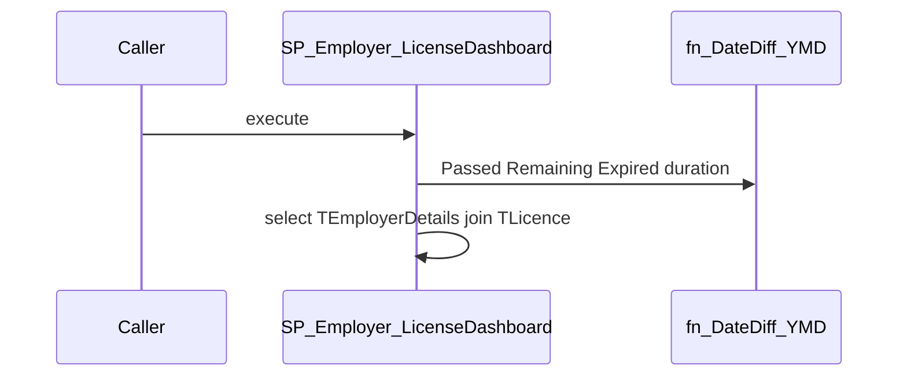
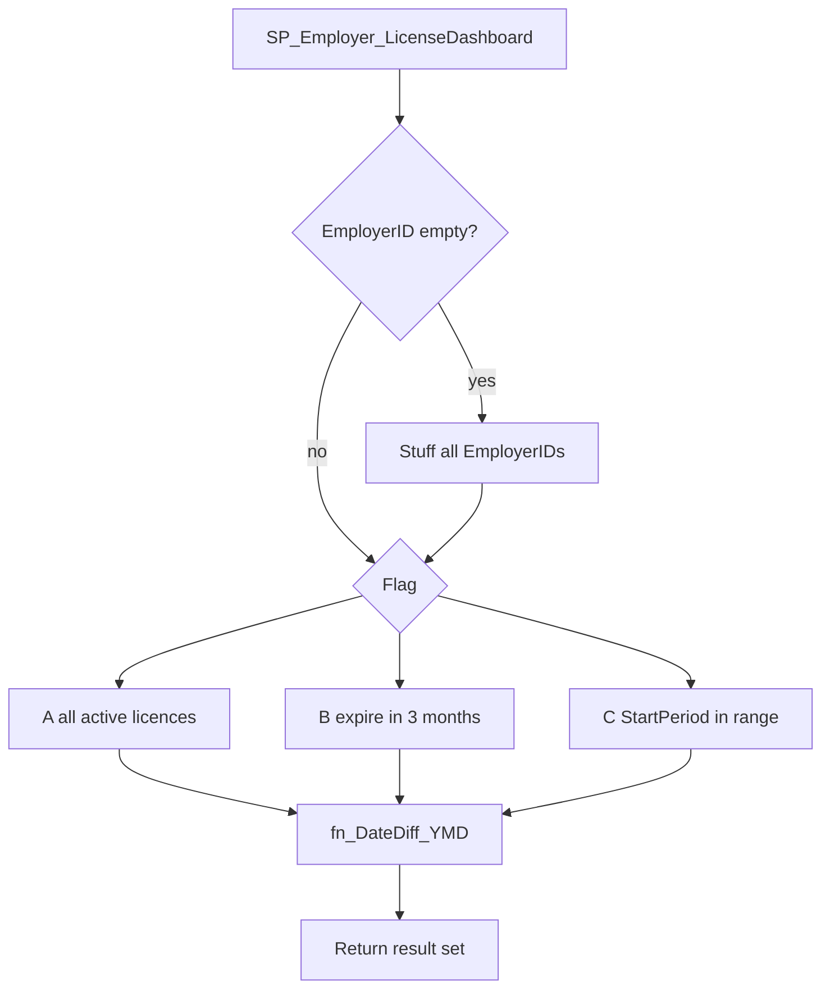

# SP_Employer_LicenseDashboard

## What it does

Returns one row per employer with an active `TLicence` for the Customer License Dashboard lifecycle chart and grid. `@Flag` selects the filter: `A` all customers, `B` subscriptions expiring within the next three months (including today), `C` customers whose `StartPeriod` falls between `@FromDate` and `@ToDate`. When `@EmployerID` is blank or `0`, every employer id from `TEmployerDetails` is concatenated and split. Each row includes license count, start/end, month buckets, an `OrgPeriod` label, and year/month/day duration strings from `fn_DateDiff_YMD`.

## Parameters

| Name | Direction | What it is for |
|---|---|---|
| `@Flag` | in | `A` all, `B` next 3 months expiry, `C` onboarded in date range |
| `@EmployerID` | in | Comma-separated employer ids, or empty/`0` for all |
| `@FromDate` | in | Used only when `@Flag = 'C'` |
| `@ToDate` | in | Used only when `@Flag = 'C'` |

## Call sequence

## Callers

| Object | Kind | Page |
|---|---|---|
| `dashBoardDAL.GetEmployerCompleteLicenseReport` | app | [Customer License Dashboard](/docs/guides/customer-license/customer-license-dashboard) |

## Nested

| Object | Kind | Page |
|---|---|---|
| `fn_DateDiff_YMD` | function | [fn_DateDiff_YMD](/docs/database/hrms/fn_DateDiff_YMD) |

## Steps

1. If `@EmployerID` is null/empty/`0`, build a comma list of every `TEmployerDetails.EmployerID`.
2. For `@Flag = 'A'`, return active licences for the employer list ordered by `StartPeriod`.
3. For `@Flag = 'B'`, keep rows whose `EndPeriod` is between today and today + 3 months (including same-day expiry).
4. For `@Flag = 'C'`, keep rows whose `StartPeriod` is between `@FromDate` and `@ToDate`.
5. Compute passed/remaining/expired months and call `fn_DateDiff_YMD` for display durations.

## Tables

| Table | Read or write |
|---|---|
| `dbo.TEmployerDetails` | read |
| `dbo.TLicence` | read |

## Unresolved calls

None.

## Flow

