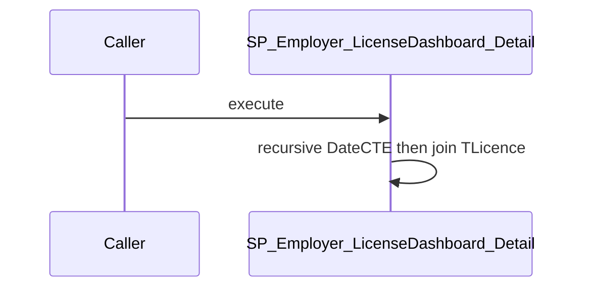
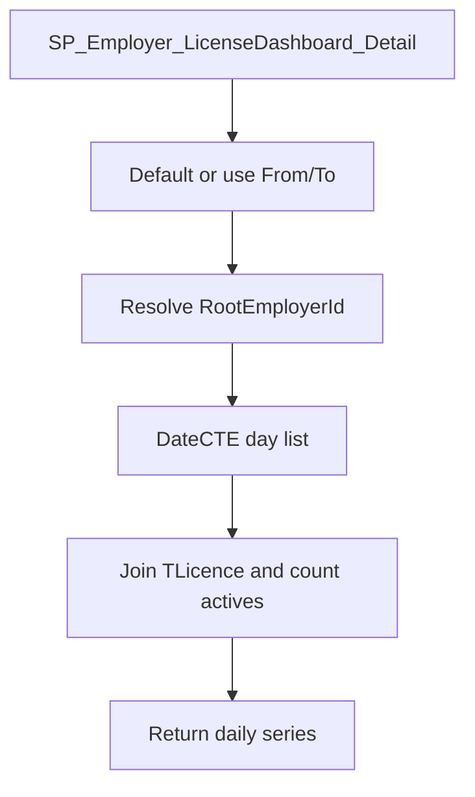

# SP_Employer_LicenseDashboard_Detail

## What it does

Builds the day-by-day license usage series for one employer in the Customer License Dashboard modal (License Usage Report). Resolves the employer's `RootEmployerId`, walks every date from `@FromDate` to `@ToDate` (default month-to-date when dates are null), and for each day returns purchased (`TotalLicence`), buffer (`BufferLicence`), and active employee headcount under that root when the report date is on or after the licence `StartPeriod`.

## Parameters

| Name | Direction | What it is for |
|---|---|---|
| `@EmployerID` | in | Employer opened from the lifecycle chart (any org in the tree) |
| `@FromDate` | in | Range start; defaults to first day of current month |
| `@ToDate` | in | Range end; defaults to today when `@FromDate` was null |

## Call sequence

Calls no other procedures or functions.

## Callers

| Object | Kind | Page |
|---|---|---|
| `dashBoardDAL.GetEmployerLicenseDetails` | app | [Customer License Dashboard](/docs/guides/customer-license/customer-license-dashboard) |

## Nested

None.

## Steps

1. Default the date range to month-start through today when `@FromDate` is null.
2. Resolve `@RootEmployerId` from `TEmployerDetails` for `@EmployerID`.
3. Generate `DateCTE` from `@FromDate` through `@ToDate` (`MAXRECURSION 0`).
4. Cross join active `TLicence` for that root and count distinct active employees with DOJ/LWD covering each report date.
5. Return `ReportDate`, `ActiveEmployeeCount`, `TotalLicence`, `BufferLicence`.

## Tables

| Table | Read or write |
|---|---|
| `dbo.TEmployerDetails` | read |
| `dbo.TLicence` | read |
| `dbo.TEmployee` | read |
| `dbo.TEmployeeInfo` | read |

## Unresolved calls

None.

## Flow

