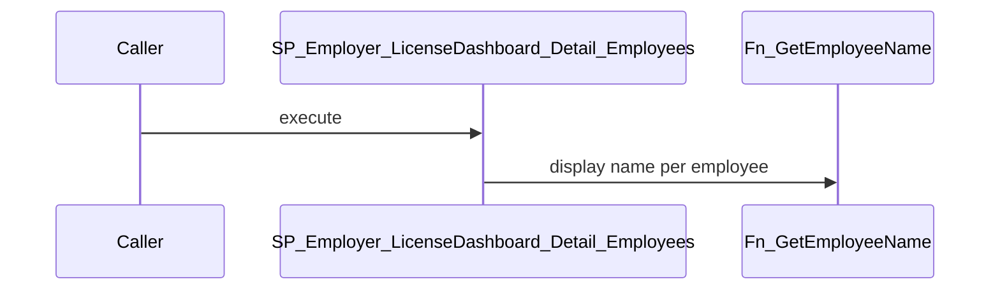
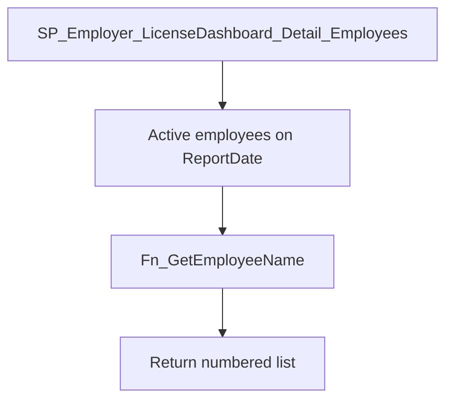

# SP_Employer_LicenseDashboard_Detail_Employees

## What it does

Lists active employees for one report date in the License Usage Report modal drill-down. Returns serial number, employment number, display name via `Fn_GetEmployeeName`, business unit, and designation for employees whose DOJ/LWD cover `@ReportDate` under employers whose `RootEmployerID` equals `@EmployerID`.

Note: the procedure assigns `@RootEmployerId` from the input employer but the `WHERE` clause filters `ED.RootEmployerID = @EmployerID`. Callers that pass the licence's root employer id (as the dashboard chart does) still work.

## Parameters

| Name | Direction | What it is for |
|---|---|---|
| `@EmployerID` | in | Treated as the root employer id in the filter |
| `@ReportDate` | in | Snapshot date for active membership |

## Call sequence

## Callers

| Object | Kind | Page |
|---|---|---|
| `dashBoardDAL.GetEmployerLicenseActiveEmployeeListByDate` | app | [Customer License Dashboard](/docs/guides/customer-license/customer-license-dashboard) |

## Nested

| Object | Kind | Page |
|---|---|---|
| `Fn_GetEmployeeName` | function | [Fn_GetEmployeeName](/docs/database/hrms/Fn_GetEmployeeName) |

## Steps

1. Look up `@RootEmployerId` (unused in the final filter).
2. Select active `TEmployee` / `TEmployeeInfo` rows under `RootEmployerID = @EmployerID` covering `@ReportDate`.
3. Left join `TorgHierarchyDetails` and `TTitle` for unit and designation.
4. Order by employment number and number the rows.

## Tables

| Table | Read or write |
|---|---|
| `dbo.TEmployerDetails` | read |
| `dbo.TEmployeeInfo` | read |
| `dbo.TEmployee` | read |
| `dbo.TorgHierarchyDetails` | read |
| `dbo.TTitle` | read |

## Unresolved calls

None.

## Flow

