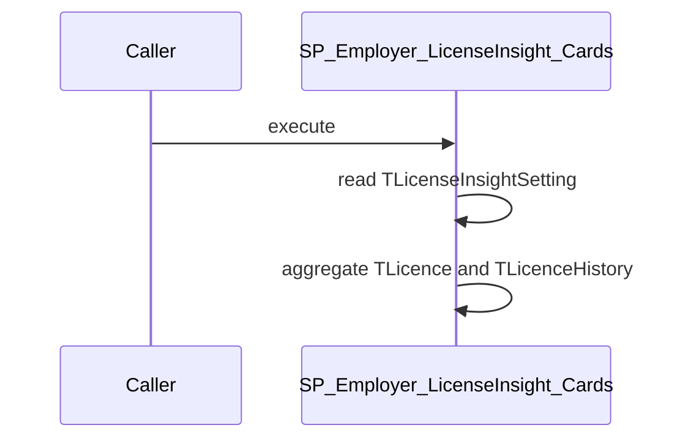
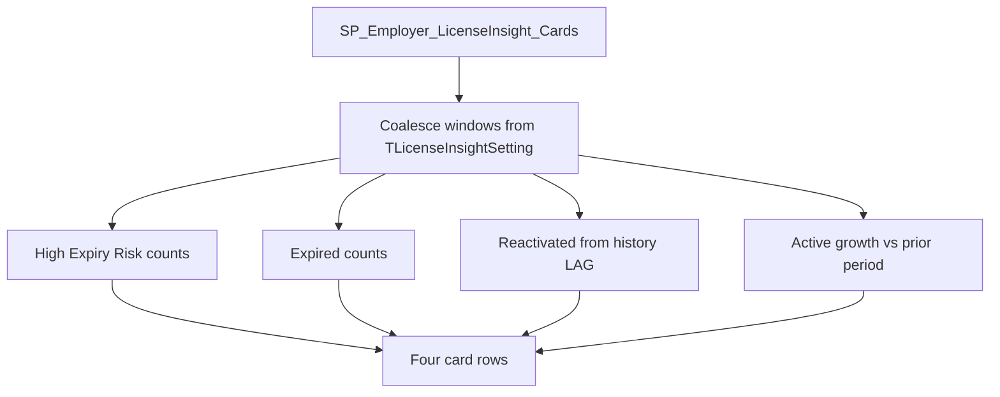

# SP_Employer_LicenseInsight_Cards

## What it does

Builds the four subscription AI insight cards on the Customer License Dashboard: High Expiry Risk, Expired Customers, Reactivated Customers, and Active Growth. Optional window parameters coalesce to `TLicenseInsightSetting` (then hard-coded defaults). Counts come from `TLicence` / `TLicenceHistory` joined to non-deleted `TEmployerDetails`. Returns one result set with four rows; `InsightType` values match `SP_Employer_LicenseInsight_Detail`.

## Parameters

| Name | Direction | What it is for |
|---|---|---|
| `@ExpiryWindowDays` | in | Days ahead for High Expiry Risk. Default from settings / 30 |
| `@ExpiredMonitoringDays` | in | Lookback for Expired Customers. Default from expiry window / 30 |
| `@ReactivationWindowDays` | in | Max gap between old expiry and revival. Default from settings / 15 |
| `@GrowthComparisonDays` | in | Comparison period for Active Growth and expiry trend. Default from settings / 30 |

## Call sequence

Calls no other procedures or functions.

## Callers

| Object | Kind | Page |
|---|---|---|
| `LicenseInsightCardsDAL.list` | app | [Customer License Dashboard](/docs/guides/customer-license/customer-license-dashboard) |

## Nested

None.

## Steps

1. Resolve windows and `EXPIRY_ALERT_COUNT` from `TLicenseInsightSetting`.
2. Count distinct employers with `EndPeriod` inside the expiry window; reconstruct the prior-period count from `TLicenceHistory`.
3. Count recently expired employers.
4. Detect reactivations from history LAG where the previous end was already past and the gap is within the reactivation window.
5. Compare current vs prior active licence counts for growth percent.
6. Return four UNION ALL card rows with summary text and highlight flags.

## Tables

| Table | Read or write |
|---|---|
| `dbo.TLicenseInsightSetting` | read |
| `dbo.TLicence` | read |
| `dbo.TLicenceHistory` | read |
| `dbo.TEmployerDetails` | read |

## Unresolved calls

None.

## Flow

