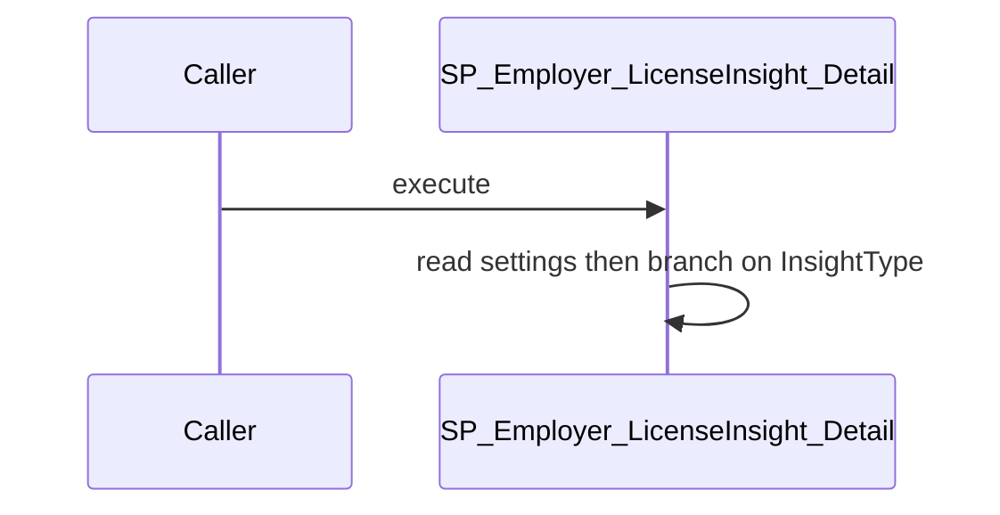
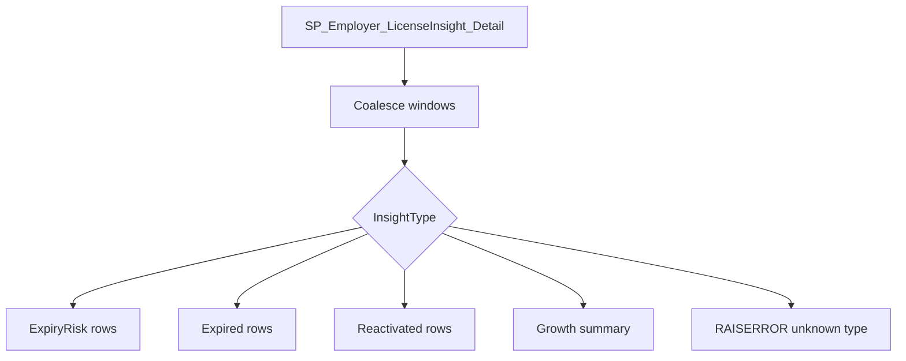

# SP_Employer_LicenseInsight_Detail

## What it does

Returns the drill-down grid behind one AI insight card. `@InsightType` selects ExpiryRisk, Expired, Reactivated, or Growth. Window parameters coalesce from `TLicenseInsightSetting` the same way as the cards procedure so card counts and detail rows stay aligned. Period display strings (`RemainingPeriod`, `ExpiredPeriod`, `PassedPeriod`) are built inline with `CROSS APPLY`, not via `fn_DateDiff_YMD`.

## Parameters

| Name | Direction | What it is for |
|---|---|---|
| `@InsightType` | in | `ExpiryRisk`, `Expired`, `Reactivated`, or `Growth` |
| `@ExpiryWindowDays` | in | Optional; settings / 30 |
| `@ExpiredMonitoringDays` | in | Optional; same default as expiry window |
| `@ReactivationWindowDays` | in | Optional; settings / 15 |
| `@GrowthComparisonDays` | in | Optional; settings / 30 |

## Call sequence

Calls no other procedures or functions.

## Callers

| Object | Kind | Page |
|---|---|---|
| `LicenseInsightDetailDAL.list` | app | [Customer License Dashboard](/docs/guides/customer-license/customer-license-dashboard) |

## Nested

None.

## Steps

1. Resolve windows from `TLicenseInsightSetting` when parameters are omitted.
2. `ExpiryRisk` — employers whose `EndPeriod` is within the window, with remaining days/period and status.
3. `Expired` — employers whose `EndPeriod` fell inside the monitoring lookback.
4. `Reactivated` — latest history-based revival per employer within the reactivation gap.
5. `Growth` — single summary row comparing prior vs current active counts.
6. Unknown `@InsightType` raises an error.

## Tables

| Table | Read or write |
|---|---|
| `dbo.TLicenseInsightSetting` | read |
| `dbo.TLicence` | read |
| `dbo.TLicenceHistory` | read |
| `dbo.TEmployerDetails` | read |

## Unresolved calls

None.

## Flow

