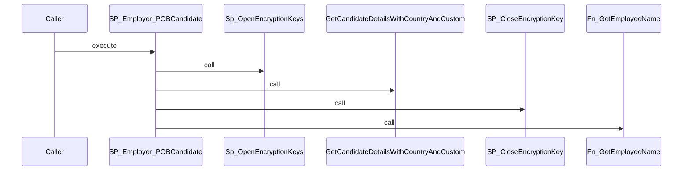
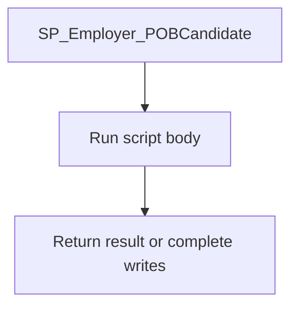

# SP_Employer_POBCandidate

## What it does

Builds the Pre-Onboarding Candidate Report result sets for an employer and optional date/status filters.

## Parameters

| Name | Direction | What it is for |
|---|---|---|
| `@EmployerID` | in | INT |
| `@StartDate` | in | DATETIME |
| `@EndDate` | in | DATETIME |
| `@Status` | in | VARCHAR |

## Call sequence

## Callers

Application callers include Core API `preOnBoardingDAL` methods used by **Employee Management → Pre-Onboarding Candidate** (`PreOnboardCandidate.aspx`). Search HRMS `STOREPROCEDURE/` and `FUNCTIONS/` for additional `EXEC`/`dbo.` callers when extending this page.

## Nested

| Object | Kind | When | Page |
|---|---|---|---|
| `Sp_OpenEncryptionKeys` | procedure | always when reached | [Sp_OpenEncryptionKeys](/docs/database/hrms/Sp_OpenEncryptionKeys) |
| `GetCandidateDetailsWithCountryAndCustom` | procedure | always when reached | [GetCandidateDetailsWithCountryAndCustom](/docs/database/hrms/GetCandidateDetailsWithCountryAndCustom) |
| `SP_CloseEncryptionKey` | procedure | always when reached | [SP_CloseEncryptionKey](/docs/database/hrms/SP_CloseEncryptionKey) |
| `Fn_GetEmployeeName` | function | always when reached | [Fn_GetEmployeeName](/docs/database/hrms/Fn_GetEmployeeName) |

## Steps

From `HRMS-DATABASE/HRMS/STOREPROCEDURE/SP_Employer_POBCandidate.sql`:

1. Executes `Sp_OpenEncryptionKeys`.
2. Executes `GetCandidateDetailsWithCountryAndCustom`.
3. Executes `SP_CloseEncryptionKey`.

## Tables

| Table | Read or write |
|---|---|
| `dbo.TEmployeeDetail_Fields` | read |
| `dbo.POBCandidate` | read |
| `dbo.POBCandidateTemplate` | read |
| `dbo.POBCandidateLogin` | read |
| `dbo.TRRSCandidate` | read |
| `dbo.temployeedetail_fields_pob_mapping` | read |
| `dbo.POBLookupItems` | read |
| `dbo.POBLookupEmployerMapping` | read |
| `dbo.POBLookupMaster` | read |
| `dbo.POBTemplate` | read |
| `dbo.POBTemplateFields` | read |
| `dbo.NormalFields` | read |
| `dbo.CustomFields` | read |
| `dbo.TCOUNTRY` | read |
| `dbo.TEMAILCOMMUNICATION` | read |
| `dbo.POBCandidateAttachment` | read |
| `dbo.tLanguage` | read |
| `dbo.LatestAttachment` | read |
| `dbo.tReligion` | read |
| `dbo.TPersonalTitle` | read |
| `dbo.TMaritalStatus` | read |
| `dbo.POBCandidateFamilyDetails` | read |
| `dbo.TEmergencyRelationship` | read |
| `dbo.TGender` | read |
| `dbo.POBContactDetails` | read |
| `dbo.POBCandidateEmergencyContacts` | read |
| `dbo.POBCandidateEducationDetails` | read |
| `dbo.TUniversity` | read |
| `dbo.TEstablishmentType` | read |
| `dbo.TEstablishmentName` | read |
| `dbo.TQualificationName` | read |
| `dbo.TSubject` | read |
| `dbo.TMajorField` | read |
| `dbo.TMinorField` | read |
| `dbo.TQualificationLevel` | read |
| `dbo.TAccountType` | read |
| `dbo.POBCandidateBankDetails` | read |
| `dbo.POBPastEmploymentDetails` | read |
| `dbo.TMSkills` | read |
| `dbo.POBCandidateSkillsDetail` | read |
| `dbo.TSkillDomainMaster` | read |
| `dbo.POBEmployeeDomainDetails` | read |
| `dbo.TVisaType` | read |
| `dbo.POBvisaPassportdetails` | read |
| `dbo.TAttachmentCategory` | read |
| `dbo.POBPreOfferCandiadteAttachment` | read |

## Unresolved calls

Uses `sp_executesql` (dynamic SQL). Do not guess the object name built at runtime.

## Flow

