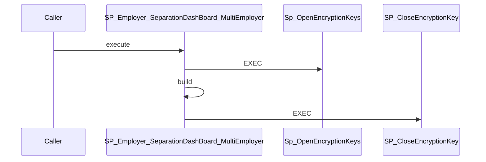
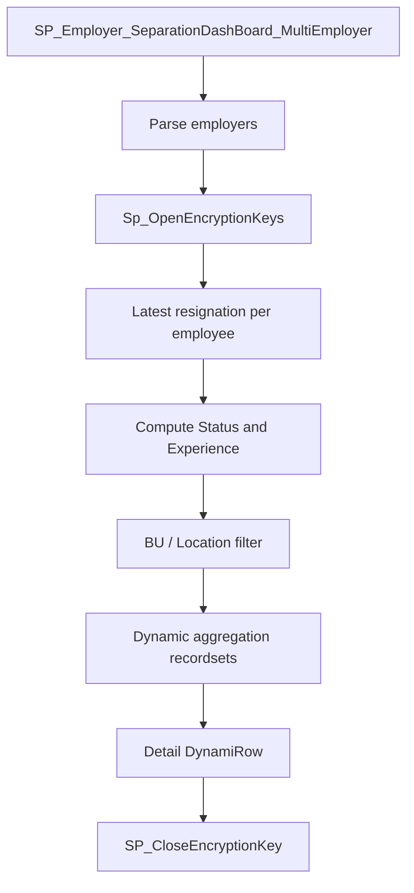

# SP_Employer_SeparationDashBoard_MultiEmployer

## What it does

Multi-employer analytics for the Separation Dashboard charts. `@ReportType` selects Active Resignation (`A`), Left Employees (`B`), or Resignation Pullback (`C`). It builds a temp set of each employee’s latest `TResignationDetails` row inside the selected employers, applies BU/location filters, computes status labels from `TRequestWorkflows` / `TActivityDetails`, then returns a series of grouped count/percentage recordsets (status, business unit, reason, location, employment type, notice period, trend, experience) plus a final employee detail grid that includes `EmployerID`. Optional comparison dates add a second `DataSet` for Left Employees comparison charts.

## Parameters

| Name | Direction | What it is for |
|---|---|---|
| `@ReportType` | in | `A` active resignation, `B` left employees, `C` resignation pullback |
| `@EmployerIDs` | in | Comma-separated employer ids (required; raises if none valid) |
| `@BUIDs` | in | Comma-separated business unit ids, or `ALL` / empty for all |
| `@LocationIDs` | in | Comma-separated location ids, or `ALL` / empty for all |
| `@FromDate` / `@ToDate` | in | Primary window (defaults `1901-01-01` through `GETDATE()` when blank) |
| `@CompFromDate` / `@CompToDate` | in | Optional comparison window for Left Employees |

## Call sequence

## Callers

| Object | Kind | Page |
|---|---|---|
| `seperationDashboardDAL.EmployerSeparationDashBoard` | app | [Separation Dashboard](/docs/guides/separation/separation-dashboard) |

## Nested

| Object | Kind | Page |
|---|---|---|
| `Sp_OpenEncryptionKeys` | procedure | [Sp_OpenEncryptionKeys](/docs/database/hrms/Sp_OpenEncryptionKeys) |
| `SP_CloseEncryptionKey` | procedure | [SP_CloseEncryptionKey](/docs/database/hrms/SP_CloseEncryptionKey) |
| `Fn_GetEmployeeName` | function | [Fn_GetEmployeeName](/docs/database/hrms/Fn_GetEmployeeName) |

Also uses `SP_EXECUTESQL` for dynamic GROUP BY result sets (not a business procedure).

## Steps

From `HRMS-DATABASE/HRMS/STOREPROCEDURE/SP_Employer_SeparationDashBoard_MultiEmployer.sql`:

1. Parse `@EmployerIDs` into `#Employers`; error if empty.
2. Open encryption keys; treat blank/`ALL` BU and location as include-all.
3. Take `MAX(ResignationDetailId)` per employee for selected employers into `#temp_Resignation`.
4. Populate `#Resignation_Data` from `TResignationDetails` joined to employee/org/reason/type tables for the report-type filter (active pending/approved resignations, pullbacks, or left employees, including inactive employees without a resignation row for `B` when needed).
5. Update `[Status]` from clearance / workflow levels; bucket `[Experience]`; drop Active rows for `B` and InActive rows for `A`/`C`.
6. Optionally delete rows outside requested BU/location id lists.
7. Drive dynamic `GROUP BY` aggregations from `@ResultSet` dimensions; emit trend and period totals; emit detail rows with `Fn_GetEmployeeName`.
8. Drop temps and close encryption keys.

## Tables

| Table | Read or write |
|---|---|
| `dbo.TResignationDetails` | read |
| `dbo.TEmployeeInfo` | read |
| `dbo.TEmployee` | read |
| `dbo.TOrgHierarchyDetails` | read |
| `dbo.TResignation` | read |
| `dbo.tLocation` | read |
| `dbo.TMEmploymentTypes` | read |
| `dbo.TSeparationType` | read |
| `dbo.TORGChart` | read |
| `dbo.TRequestWorkflows` | read |
| `dbo.TActivityDetails` | read |

## Unresolved calls

None.

## Flow

