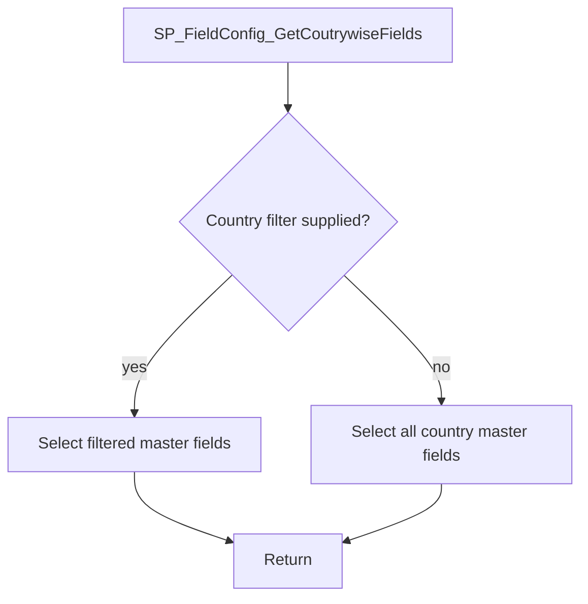

# SP_FieldConfig_GetCoutrywiseFields

## What it does

Lists non-deleted country-specific field definitions from TEmployeeDetail_Fields_Master (FieldEntity = Country). When @COUNTRYID is supplied, filters to those country ids; otherwise returns all country fields.

## Parameters

| Name | Direction | What it is for |
|---|---|---|
| `@COUNTRYID` | in | Optional comma-separated country ids; null means all |

## Call sequence

Calls no other procedures or functions.

## Callers

No other procedure or function in HRMS calls this object as a nested procedure. Application caller: Employee Information Configuration (Core WebAPI FieldConfiguration / preonboarding).

## Nested

Calls no other procedures or functions.

## Steps

1. Script is `HRMS-DATABASE/HRMS/STOREPROCEDURE/SP_FieldConfig_GetCoutrywiseFields.sql`.
2. If @COUNTRYID is not null, split into @COUNTRYS and select master country fields for those ids.
3. Else select all non-deleted Country master fields.
4. Project mandatory/mask/validation/updated metadata; order by UpdatedDate desc.

## Tables

| Table | Read or write |
|---|---|
| `TEMPLOYEEDETAIL_FIELDS_MASTER` | read |
| `TEMPLOYEEDETAIL_SECTION` | read |
| `TCOUNTRY` | read |
| `TEMPLOYEE` | read |

## Unresolved calls

None.

## Flow

