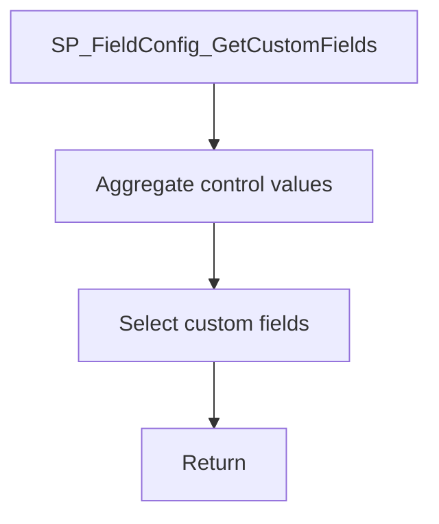

# SP_FieldConfig_GetCustomFields

## What it does

Lists non-deleted custom fields (FieldEntity = Custom) for one employer, including control type, aggregated control values, validation/date-range metadata, and formatted UpdatedDate.

## Parameters

| Name | Direction | What it is for |
|---|---|---|
| `@EmployerId` | in | Employer id |

## Call sequence

Calls no other procedures or functions.

## Callers

No other procedure or function in HRMS calls this object as a nested procedure. Application caller: Employee Information Configuration (Core WebAPI FieldConfiguration / preonboarding).

## Nested

Calls no other procedures or functions.

## Steps

1. Script is `HRMS-DATABASE/HRMS/STOREPROCEDURE/SP_FieldConfig_GetCustomFields.sql`.
2. Aggregate TEmployeedetailCustomFieldValues into #CONTROL_VALUES per CustFieldID.
3. Join TEMPLOYEEDETAIL_FIELDS to section, employer, country, field-type lookup, and OPENJSON dateRange rules.
4. Filter FieldEntity = Custom, IsDeleted = 0, employer active; return ordered by Updated_Date desc.

## Tables

| Table | Read or write |
|---|---|
| `TEMPLOYEEDETAIL_FIELDS` | read |
| `TEMPLOYEEDETAIL_SECTION` | read |
| `TEMPLOYERDETAILS` | read |
| `TEmployeedetailCustomFieldValues` | read |
| `TCOUNTRY` | read |
| `TEMPLOYEE` | read |
| `TFieldType_LOOKUP` | read |

## Unresolved calls

None.

## Flow

