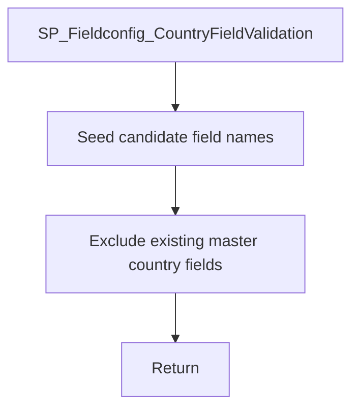

# SP_Fieldconfig_CountryFieldValidation

## What it does

Returns hardcoded candidate country field names for a section that are not yet present in TEmployeeDetail_Fields_Master for that section and country (for example National Identification Number, tax and phone fields).

## Parameters

| Name | Direction | What it is for |
|---|---|---|
| `@Sectionid` | in | Section id |
| `@Countryid` | in | Country id |

## Call sequence

Calls no other procedures or functions.

## Callers

No other procedure or function in HRMS calls this object as a nested procedure. Application caller: Employee Information Configuration (Core WebAPI FieldConfiguration / preonboarding).

## Nested

Calls no other procedures or functions.

## Steps

1. Script is `HRMS-DATABASE/HRMS/STOREPROCEDURE/SP_Fieldconfig_CountryFieldValidation.sql`.
2. Populate @FIELDS with fixed section/field-name pairs for personal, contact, emergency, and current employment sections.
3. Return FIELDNAME rows for @Sectionid that are not already in TEMPLOYEEDETAIL_FIELDS_MASTER for that section/country as Country entity.

## Tables

| Table | Read or write |
|---|---|
| `TEMPLOYEEDETAIL_SECTION` | read |
| `TEMPLOYEEDETAIL_FIELDS_MASTER` | read |

## Unresolved calls

None.

## Flow

