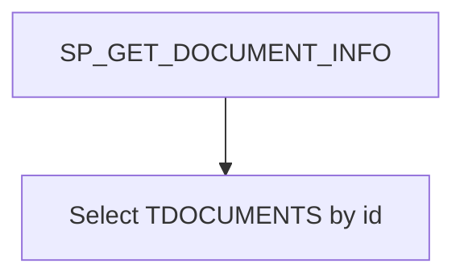

# SP_GET_DOCUMENT_INFO

## What it does

Returns metadata for one document id from `TDOCUMENTS`: `DocumentID`, `DocumentURI`, `FileName`, `FileExtension`, `CreatedBy`, `CreatedOn`. Used by BGV document download.

## Parameters

| Name | Direction | What it is for |
|---|---|---|
| `@pDocumentID` | in | Document id to load |

## Call sequence

Calls no other procedures or functions.

## Callers

No other procedure or function calls this object. Application caller: BGV API `documentDAL` download path.

## Nested

Calls no other procedures or functions.

## Steps

1. Script is `HRMS-DATABASE/HRMS/STOREPROCEDURE/SP_GET_DOCUMENT_INFO.sql`.
2. Select the matching row from `TDOCUMENTS` where `DocumentID = @pDocumentID`.

## Tables

| Table | Read or write |
|---|---|
| `dbo.TDOCUMENTS` | read |

## Flow

