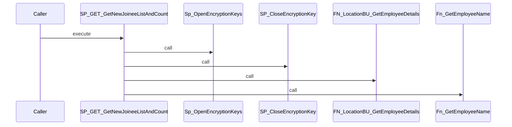
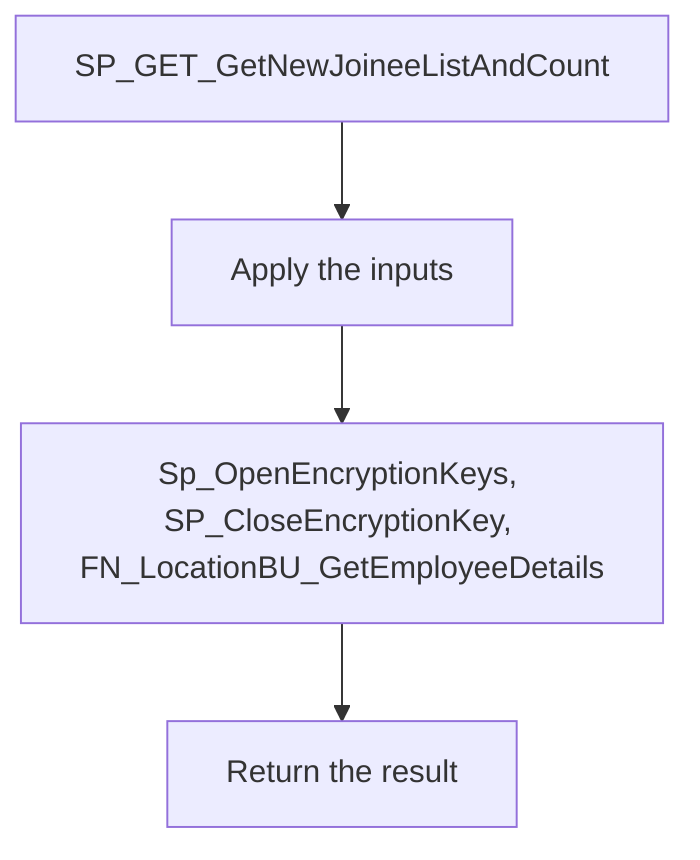

# SP_GET_GetNewJoineeListAndCount

## What it does

Returns a page of new joiners for a month, plus the count, for the New Joinee / Refer a friend card.

## Parameters

| Name | Direction | What it is for |
|---|---|---|
| `@Employerid` | in | Employer that owns the data (`INT`) |
| `@MonthDate` | in | Month the new-joinee list is for (`DATETIME`) |
| `@EmployeeId` | in | Employee the Home screen is loading or acting for (`INT`) |
| `@MultiOrg` | in | Whether the new-joinee list spans organisations (`BIT`) |
| `@PageNumber` | in | Page number for the list. Empty uses the procedure default (`INT`) |
| `@PageSize` | in | Page size for the list. Empty uses the procedure default (`INT`) |

## Call sequence

## Callers

No other procedure or function under STOREPROCEDURE or FUNCTIONS executes this object.

## Nested

| Object | Kind | When | Page |
|---|---|---|---|
| `Sp_OpenEncryptionKeys` | procedure | Called while this object runs | [Sp_OpenEncryptionKeys](/docs/database/hrms/Sp_OpenEncryptionKeys) |
| `SP_CloseEncryptionKey` | procedure | Called while this object runs | [SP_CloseEncryptionKey](/docs/database/hrms/SP_CloseEncryptionKey) |
| `FN_LocationBU_GetEmployeeDetails` | function | Called while this object runs | [FN_LocationBU_GetEmployeeDetails](/docs/database/hrms/FN_LocationBU_GetEmployeeDetails) |
| `Fn_GetEmployeeName` | function | Called while this object runs | [Fn_GetEmployeeName](/docs/database/hrms/Fn_GetEmployeeName) |

## Steps

In `HRMS-DATABASE/HRMS/STOREPROCEDURE/SP_GET_GetNewJoineeListAndCount.sql`:

1. Returns a page of new joiners for a month, plus the count, for the New Joinee / Refer a friend card.

## Tables

| Table | Read or write |
|---|---|
| `tuseremployee` | read |
| `TRRS_GRID_CONFIG` | read |
| `TEmployee` | read |
| `TEmployeeInfo` | read |
| `TAttendanceTransaction` | read |
| `TLeaveRequestDays` | read |
| `TLeaveTypeMaster` | read |
| `TEmployerDetails` | read |
| `TEmployeeContactDetails` | read |
| `TOrgHierarchyDetails` | read |
| `TTitle` | read |

## Flow

