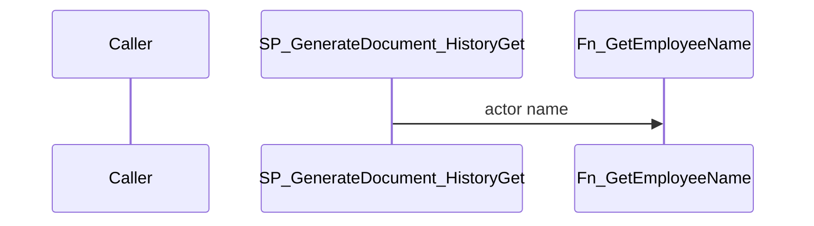
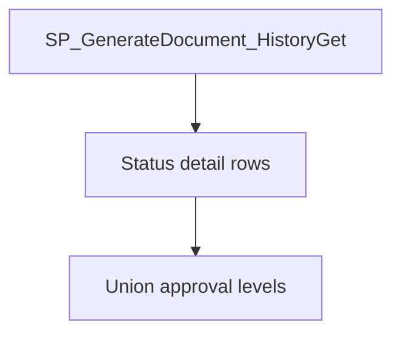

# SP_GenerateDocument_HistoryGet

## What it does

Returns status history for one generated document. Status-detail rows are unioned with approval-level rows from the workflow.

## Parameters

| Name | Direction | What it is for |
|---|---|---|
| `@EmployeeId` | in | Employee |
| `@DocumentGenerateId` | in | Generated document |

## Call sequence

## Callers

No other procedure or function calls this object.

## Nested

| Object | Kind | When | Page |
|---|---|---|---|
| `Fn_GetEmployeeName` | function | actor name | [Fn_GetEmployeeName](/docs/database/hrms/Fn_GetEmployeeName) |

## Steps

1. Select status, date, and actor from `TEmpDocGenerated_StatusDetails` (`SP_GenerateDocument_HistoryGet.sql`).
2. Union approval-level rows from the workflow for the same generated document.

## Tables

| Table | Read or write |
|---|---|
| `dbo.TEmpDocGenerated_StatusDetails` | read |
| `dbo.TEmployeeDocumentGeneratedDetails` | read |
| `dbo.tEmpDocGenerated_MasterStatus` | read |
| `dbo.tRequestWorkFlows` | read |
| `dbo.tEmployeeInfo` | read |

## Flow

