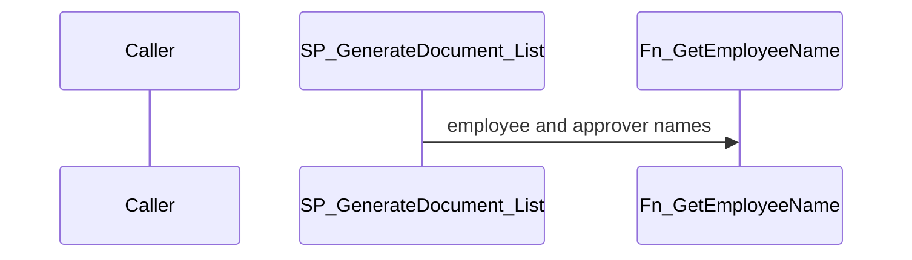
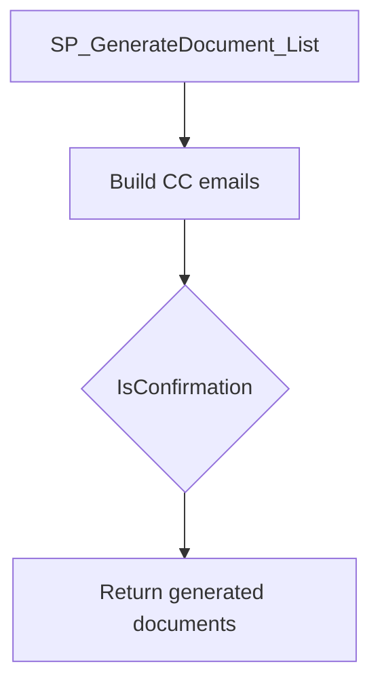

# SP_GenerateDocument_List

## What it does

Lists generated documents for an employer. Setup Employee Self Service passes IsConfirmation N, so confirmation-module documents are excluded. The row includes status, workflow id, document path, category, acceptance and timeline columns, and a comma-separated CC email list from the template.

## Parameters

| Name | Direction | What it is for |
|---|---|---|
| `@EmployerId` | in | Employer |
| `@LoggedInUserId` | in | Passed and not used in the select |
| `@IsConfirmation` | in | Y keeps confirmation modules. This screen passes N |

## Call sequence

## Callers

No other procedure or function calls this object.

## Nested

| Object | Kind | When | Page |
|---|---|---|---|
| `Fn_GetEmployeeName` | function | employee and approver names | [Fn_GetEmployeeName](/docs/database/hrms/Fn_GetEmployeeName) |

## Steps

1. Build a CC email string per template from `TDocumentTemplates.DocEmailCC` and `tEmployee` (`SP_GenerateDocument_List.sql`).
2. When `@IsConfirmation` is Y, keep modules whose name starts with Confirmation. Otherwise drop those modules.
3. Join non-deleted `TEmployeeDocumentGeneratedDetails` to the template, employee, employee info, and `tRequestWorkFlows` for DocumentBuilderESS.
4. Return employee name, status, workflow id, path, category, acceptance, timeline, and CC emails.

## Tables

| Table | Read or write |
|---|---|
| `dbo.TEmployeeDocumentGeneratedDetails` | read |
| `dbo.TDocumentTemplates` | read |
| `dbo.tEmployee` | read |
| `dbo.tEmployeeInfo` | read |
| `dbo.tRequestWorkFlows` | read |
| `dbo.THrmsModules` | read |

## Flow

