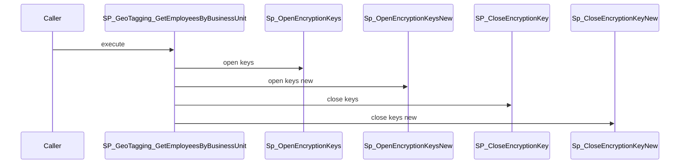
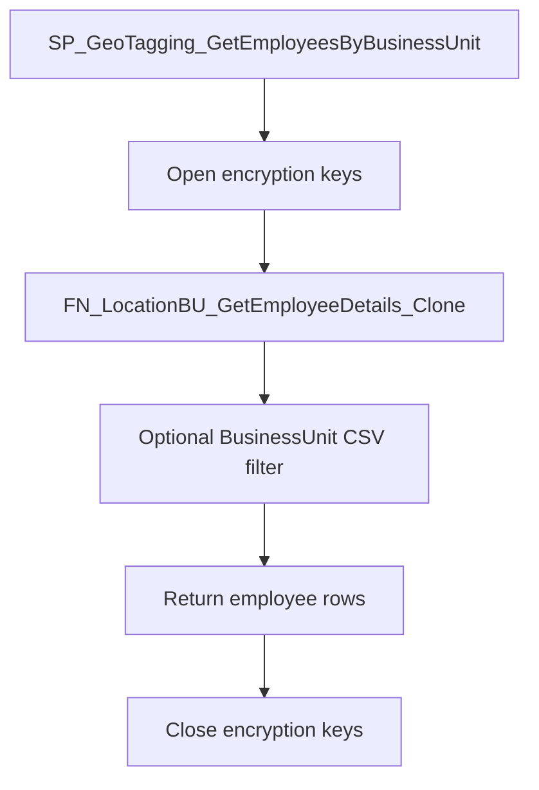

# SP_GeoTagging_GetEmployeesByBusinessUnit

## What it does

Lists active employees the caller may see for an employer, optionally filtered by a CSV of business-unit ids. Despite the GeoTagging name it is a general location/BU-scoped employee picker: it opens encryption keys for `Fn_GetEmployeeName` and restricts rows to `FN_LocationBU_GetEmployeeDetails_Clone(@LoginId, @EmployerId)`. Feedback360 uses it when selecting participants or reviewer candidates by business unit.

## Parameters

| Name | Direction | What it is for |
|---|---|---|
| `@LoginId` | in | Logged-in employee id (authorisation input, not a display filter) |
| `@EmployerId` | in | Employer scope |
| `@BusinessUnit` | in | Optional CSV of `BusinessUnitId` values; NULL/empty = all units in access |

## Call sequence

## Callers

Application caller: Core API `Feedback360DAL.GetEmployeesByBusinessUnit` for Performance Assessment → 360° Feedback (`Feedback360.aspx`). Also used by GeoTagging / bulk-profile style screens.

| Object | Kind | Page |
|---|---|---|
| _(application)_ | Core API | [360° Feedback guide](/docs/guides/performance-assessment/360-feedback) |

## Nested

| Object | Kind | When | Page |
|---|---|---|---|
| `Sp_OpenEncryptionKeys` | procedure | start of batch | [Sp_OpenEncryptionKeys](/docs/database/hrms/Sp_OpenEncryptionKeys) |
| `Sp_OpenEncryptionKeysNew` | procedure | start of batch | [Sp_OpenEncryptionKeysNew](/docs/database/hrms/Sp_OpenEncryptionKeysNew) |
| `SP_CloseEncryptionKey` | procedure | end of batch | [SP_CloseEncryptionKey](/docs/database/hrms/SP_CloseEncryptionKey) |
| `Sp_CloseEncryptionKeyNew` | procedure | end of batch | [Sp_CloseEncryptionKeyNew](/docs/database/hrms/Sp_CloseEncryptionKeyNew) |

Also uses `Fn_GetEmployeeName` and `FN_LocationBU_GetEmployeeDetails_Clone` (functions).

## Steps

1. Open encryption key pairs.
2. Parse `@BusinessUnit` CSV into a table variable when provided.
3. Select active employees for `@EmployerId` that appear in the caller’s location/BU access function, optionally filtered by business unit.
4. Return id, display name (`Name(EmploymentNumber)`), employer, employment number, business unit, designation, location.
5. Close encryption key pairs.
6. Script path: `HRMS-DATABASE/HRMS/STOREPROCEDURE/SP_GeoTagging_GetEmployeesByBusinessUnit.sql`.

## Tables

| Table | Read or write |
|---|---|
| `dbo.TEmployee` | read |
| `dbo.TEmployeeInfo` | read |
| `dbo.TEmployerDetails` | read |
| `dbo.TLocation` | read |
| `dbo.TOrgHierarchyDetails` | read |
| `dbo.TTitle` | read |

## Flow

