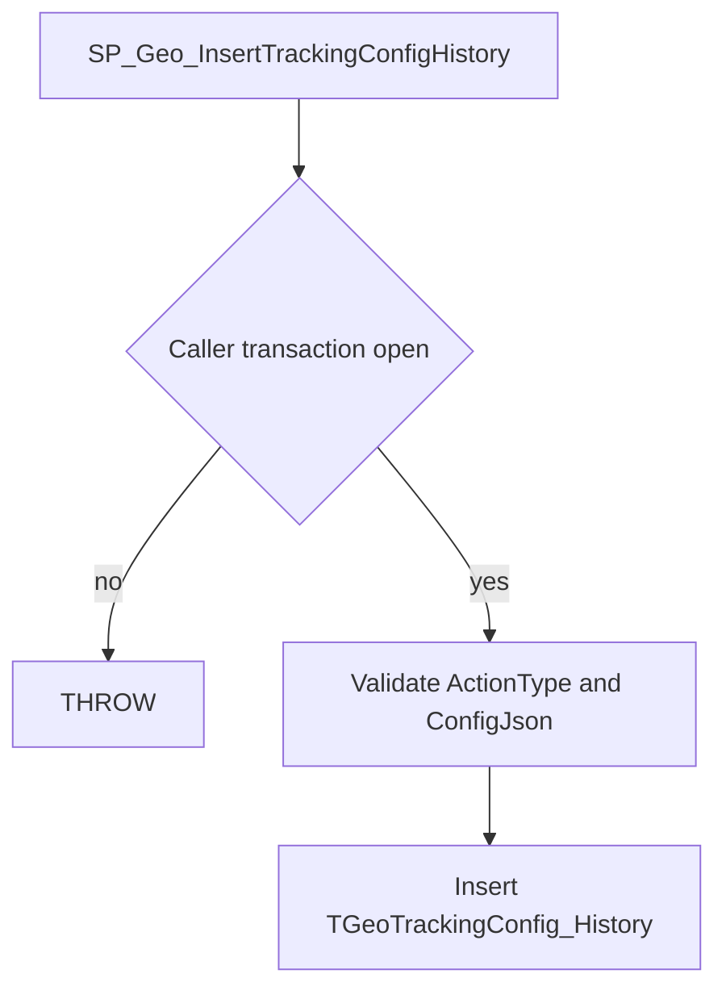

# SP_Geo_InsertTrackingConfigHistory

## What it does

Inserts one Added or Updated audit row into `TGeoTrackingConfig_History`. It must run inside the caller's open transaction. It validates `ActionType` and that `ConfigJson` is valid JSON, then sets Comment, ActionOn, and ActionByEmployeeId from the parameters.

## Parameters

| Name | Direction | What it is for |
|---|---|---|
| `@GeoTrackingConfigId` | in | Config identity |
| `@EmployerId` | in | Employer |
| `@EmployeeId` | in | Configured employee |
| `@TrackingInterval` | in | Interval snapshot |
| `@DistanceFilter` | in | Distance snapshot |
| `@IsActive` | in | Active snapshot |
| `@CreatedOn` | in | CreatedOn snapshot |
| `@UpdatedOn` | in | UpdatedOn snapshot |
| `@TrackingIsAuto` | in | Auto flag snapshot |
| `@TrackingOnShift` | in | Shift flag snapshot |
| `@startTime` | in | Start time snapshot |
| `@endTime` | in | End time snapshot |
| `@IsAttendanceBasedTrackingEnabled` | in | Attendance mode snapshot |
| `@ActionType` | in | `Added` or `Updated` |
| `@ConfigJson` | in | JSON document of post-save display state |
| `@ActionByEmployeeId` | in | Actor employee id |

## Call sequence

Calls no other procedures or functions.

## Callers

| Object | Kind | Page |
|---|---|---|
| `SP_InsertTrackingConfiguration` | procedure | [SP_InsertTrackingConfiguration](/docs/database/hrms/SP_InsertTrackingConfiguration) |

## Nested

Calls no other procedures or functions.

## Steps

1. In `HRMS-DATABASE/HRMS/STOREPROCEDURE/SP_Geo_InsertTrackingConfigHistory.sql`, set `NOCOUNT` and `XACT_ABORT ON`.
2. If `@@TRANCOUNT = 0`, throw that the history procedure must run inside the configuration transaction.
3. If `@ActionType` is not `Added` or `Updated`, throw.
4. If `ISJSON(@ConfigJson) <> 1`, throw.
5. Insert one `TGeoTrackingConfig_History` row. Comment is `Newly added` or `Existing configuration updated`. `ActionOn` is `@CreatedOn` for Added and `@UpdatedOn` for Updated.

## Tables

| Table | Read or write |
|---|---|
| `dbo.TGeoTrackingConfig_History` | write |

## Flow

