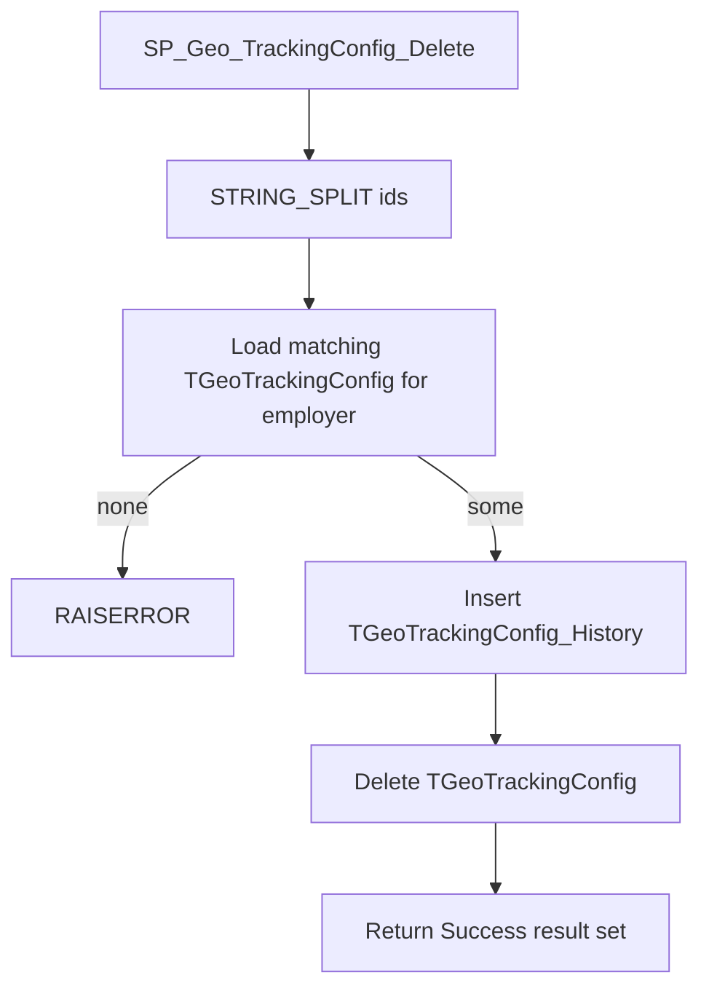

# SP_Geo_TrackingConfig_Delete

## What it does

Deletes one or more `TGeoTrackingConfig` rows for a given employer. It parses a comma-separated id list, copies matching rows into `TGeoTrackingConfig_History` (without ActionType/ConfigJson columns used by the insert-history path), then deletes the live rows. Returns a success result set with deleted and not-found counts.

## Parameters

| Name | Direction | What it is for |
|---|---|---|
| `@GeoTrackingConfigIds` | in | Comma-separated config ids |
| `@EmployerId` | in | Employer that must own the rows |

## Call sequence

Calls no other procedures or functions.

## Callers

No other procedure or function calls this object. `GeoTrackingDAL.DeleteTrackingConfiguration` executes it.

## Nested

Calls no other procedures or functions.

## Steps

1. In `HRMS-DATABASE/HRMS/STOREPROCEDURE/SP_Geo_TrackingConfig_Delete.sql`, require non-empty `@GeoTrackingConfigIds` and a positive `@EmployerId`.
2. Begin a transaction. Split ids into `#GeoTrackingConfigIdsToDelete` via `STRING_SPLIT`.
3. Load matching `TGeoTrackingConfig` rows for that employer into `#GeoTrackingConfigRecordsToDelete`.
4. If none match, raise and return (transaction rolls back in `CATCH`).
5. Insert those rows into `TGeoTrackingConfig_History`.
6. Delete from `TGeoTrackingConfig` for the same ids and employer.
7. Return a single result row with `Success`, `Message`, counts, and id lists. Commit.

## Tables

| Table | Read or write |
|---|---|
| `dbo.TGeoTrackingConfig` | read and write |
| `dbo.TGeoTrackingConfig_History` | write |

## Flow

