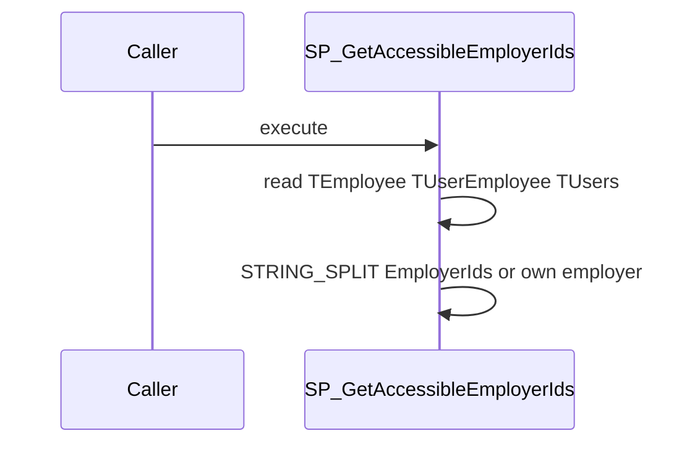
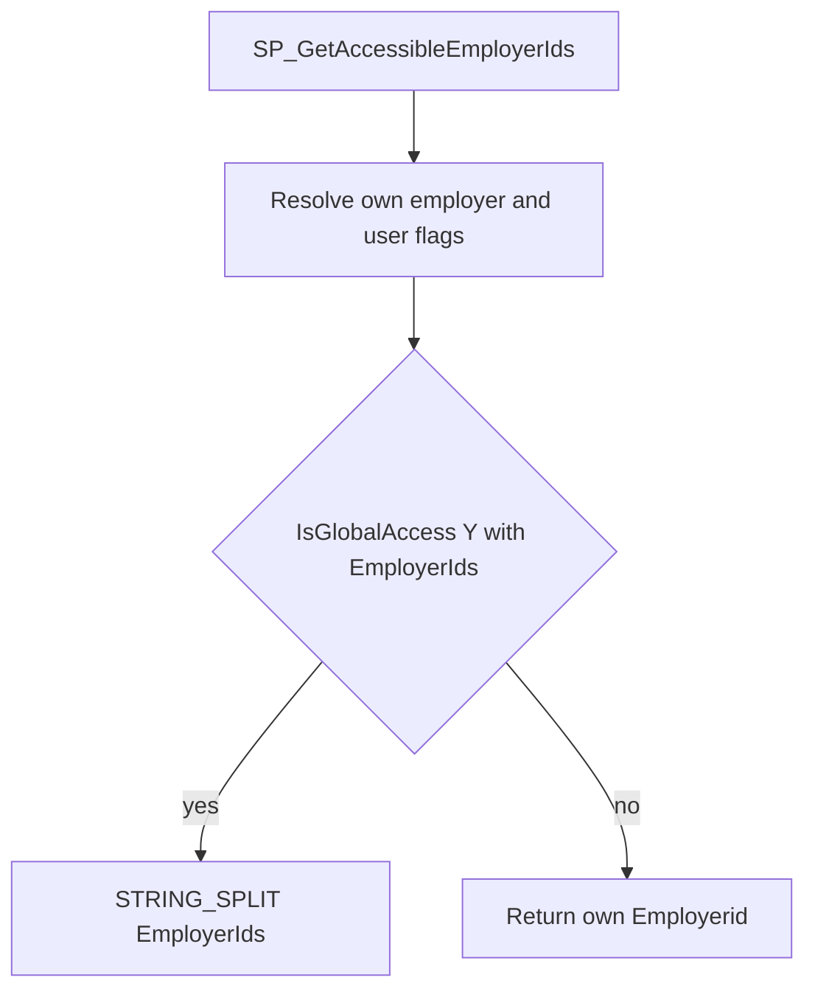

# SP_GetAccessibleEmployerIds

## What it does

Returns the set of employer ids an employee may access. Resolves the employee’s own employer and the linked user’s `IsGlobalAccess` / `EmployerIds` flags. When global access is `Y` and `EmployerIds` is a non-empty comma-separated list, each listed id is returned; otherwise only the employee’s own employer id is returned (if present).

## Parameters

| Name | Direction | What it is for |
|---|---|---|
| `@EmployeeId` | in | Employee whose access list to resolve |

## Call sequence

Calls no other procedures or functions.

## Callers

Procedures and functions that call this object.

No other procedure or function calls this object. App callers include `getAccessibleEmployerIdsRepo` used by Cross Client Dashboard BLL (`getCrossClientOverview`) and employer access-validation features.

## Nested

| Object | Kind | When | Page |
|---|---|---|---|
| *(none)* | — | — | — |

## Steps

1. Script is `HRMS-DATABASE/HRMS/STOREPROCEDURE/SP_GetAccessibleEmployerIds.sql`.
2. Select top user row for `@EmployeeId` via `TEmployee` → `TUserEmployee` → `TUsers` (deterministic `UserID DESC` if multiple).
3. If `IsGlobalAccess = 'Y'` and `EmployerIds` is non-blank, `STRING_SPLIT` that list into `Employerid` rows.
4. Else return the employee’s own `@OwnEmployerId` when not null.

## Tables

| Table | Read or write |
|---|---|
| `dbo.TEmployee` | read |
| `dbo.TUserEmployee` | read |
| `dbo.TUsers` | read |

## Unresolved calls

None. `STRING_SPLIT` is a built-in table-valued function, not a nested procedure.

## Flow

