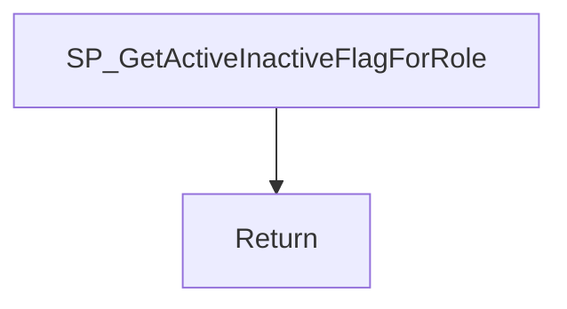

# SP_GetActiveInactiveFlagForRole

## What it does

Stored procedure `SP_GetActiveInactiveFlagForRole`. Reads `TRollWisePageAccess`. Calls no other procedure or function.

## Parameters

| Name | Direction | What it is for |
|---|---|---|
| `@employerId` | in | Int |
| `@roleId` | in | Int |
| `@pageTabID` | in | Int |
| `@Employeeid` | in | Int |

## Call sequence

Calls no other procedures or functions.

## Callers

No other procedure or function calls this object.

## Nested

Calls no other procedures or functions.

## Steps

1. Script is `HRMS-DATABASE/HRMS/STOREPROCEDURE/SP_GetActiveInactiveFlagForRole.sql`.

## Tables

| Table | Read or write |
|---|---|
| `TRollWisePageAccess` | read |

## Flow

