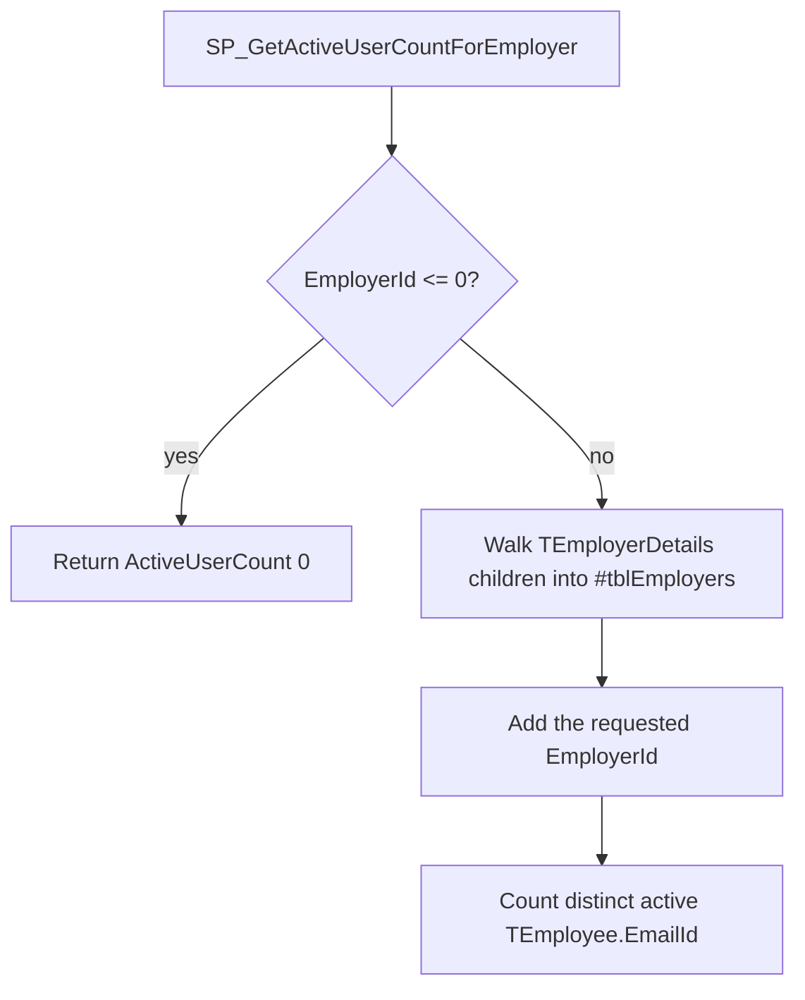

# SP_GetActiveUserCountForEmployer

## What it does

The procedure returns one number, `ActiveUserCount`, for license checks. When `@EmployerId` is zero or negative it returns 0. Otherwise it counts distinct active employee email addresses on that employer and on every descendant employer found by walking `TEmployerDetails.ParentEmployerid`. The header comment in `HRMS-DATABASE/HRMS/STOREPROCEDURE/SP_GetActiveUserCountForEmployer.sql` says it was created for license activity.

## Parameters

| Name | Direction | What it is for |
|---|---|---|
| `@EmployerId` | in | Employer to count. Values of 0 or less return 0 without reading employees. |

## Call sequence

Calls no other procedures or functions.

## Callers

No other procedure or function calls this object.

## Nested

Calls no other procedures or functions.

## Steps

1. In `HRMS-DATABASE/HRMS/STOREPROCEDURE/SP_GetActiveUserCountForEmployer.sql`, if `@EmployerId <= 0`, select `0` as `ActiveUserCount` and stop.
2. Otherwise create `#tblEmployers` (`EmployerId INT`).
3. Recursive CTE `tblchild` reads `TEmployerDetails` where `ParentEmployerid = @EmployerId`, then repeats for each child. `OPTION (MAXRECURSION 32767)` is on the final select.
4. Insert those child `EmployerId` values into `#tblEmployers`, and also insert `@EmployerId`.
5. Select `count(DISTINCT E.EmailId)` as `ActiveUserCount` from `TEmployee E` joined to `TEmployeeInfo EI` on `EmployeeId`, where `E.EmployerId` is in `#tblEmployers` and `E.IsActive = 'Y'`.

The employee filter uses `TEmployee.EmployerId`. `TEmployeeInfo` is joined and is not used in the `WHERE` clause. `TEmployee.Employerid` has no foreign key to `TEmployerDetails`. `ParentEmployerid` has no foreign key either.

## Tables

| Table | Read or write |
|---|---|
| `dbo.TEmployerDetails` | read |
| `dbo.TEmployee` | read |
| `dbo.TEmployeeInfo` | read |
| `#tblEmployers` | write, then read (temp table) |

## Flow

