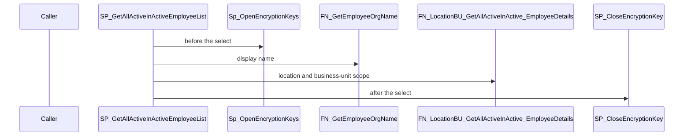
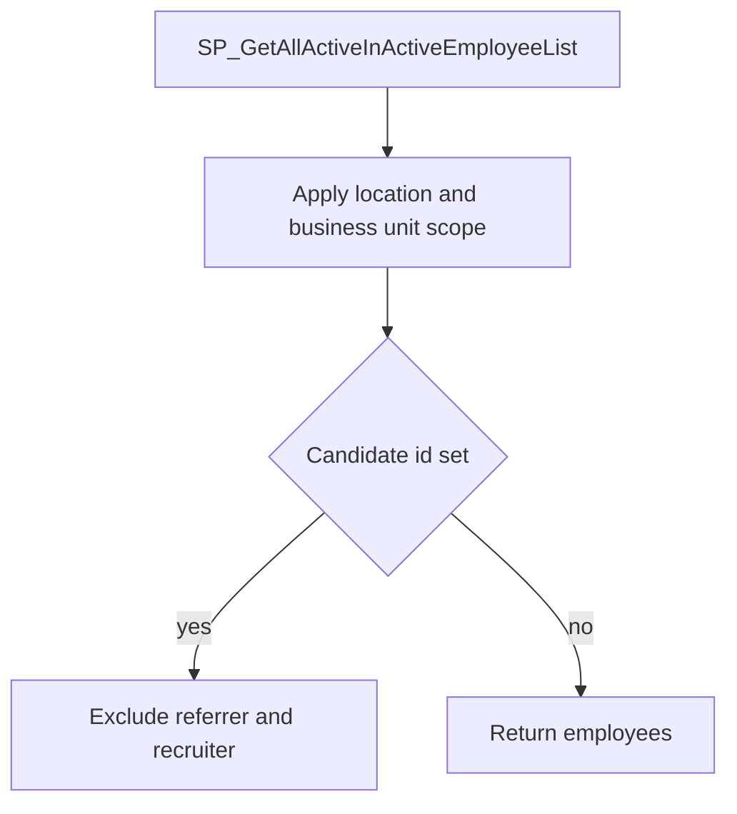

# SP_GetAllActiveInActiveEmployeeList

## What it does

Returns employees for one employer except pending employees. The name includes the organization label. The list is limited to employees in the caller's location and business-unit scope. An optional candidate id excludes the referring employee and the assigned recruiter.

## Parameters

| Name | Direction | What it is for |
|---|---|---|
| `@EmployerId` | in | Employer |
| `@CandidateId` | in | Optional candidate used to exclude a referrer and recruiter |
| `@EmployeeId` | in | User whose location and business-unit scope is applied |

## Call sequence

## Callers

No other procedure or function calls this object.

## Nested

| Object | Kind | When | Page |
|---|---|---|---|
| `Sp_OpenEncryptionKeys` | procedure | before the select | [Sp_OpenEncryptionKeys](/docs/database/hrms/Sp_OpenEncryptionKeys) |
| `FN_GetEmployeeOrgName` | function | display name | [FN_GetEmployeeOrgName](/docs/database/hrms/FN_GetEmployeeOrgName) |
| `FN_LocationBU_GetAllActiveInActive_EmployeeDetails` | function | location and business-unit scope | [FN_LocationBU_GetAllActiveInActive_EmployeeDetails](/docs/database/hrms/FN_LocationBU_GetAllActiveInActive_EmployeeDetails) |
| `SP_CloseEncryptionKey` | procedure | after the select | [SP_CloseEncryptionKey](/docs/database/hrms/SP_CloseEncryptionKey) |

## Steps

1. Open encryption keys (`SP_GetAllActiveInActiveEmployeeList.sql`).
2. Select employees for `@EmployerId` whose `IsActive` is not P.
3. Keep only employees returned by `FN_LocationBU_GetAllActiveInActive_EmployeeDetails` for `@EmployeeId`.
4. When `@CandidateId` is set, exclude the referrer and the recruiter.
5. Close the encryption key.

## Tables

| Table | Read or write |
|---|---|
| `dbo.TEmployee` | read |
| `dbo.TEmployeeInfo` | read |
| `dbo.TTitle` | read |
| `dbo.TEmployerDetails` | read |
| `dbo.TRRSCandidate` | read |
| `dbo.TRecruiter` | read |

## Flow

