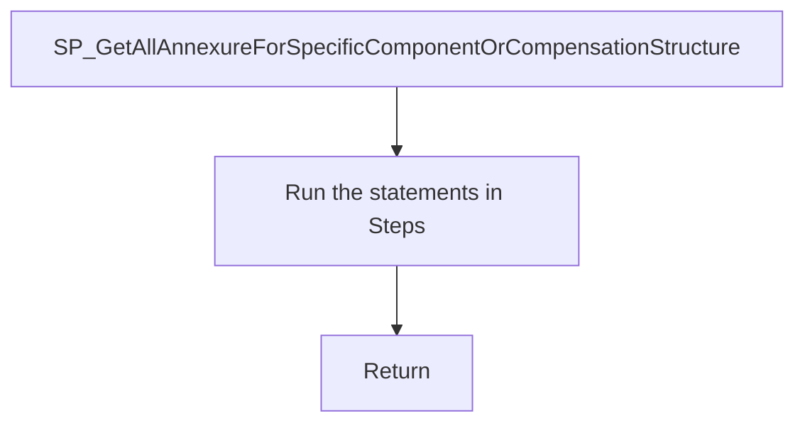

# SP_GetAllAnnexureForSpecificComponentOrCompensationStructure

## What it does

Returns comma-separated annexure names (and related component names when a component id is supplied) for dependency checks before delete/edit.

## Parameters

| Name | Direction | What it is for |
|---|---|---|
| `@ComponentId` | in | Optional component id |
| `@CompensationStructureId` | in | Structure scope |

## Call sequence

Calls no other procedures or functions.

## Callers

No other procedure or function calls this object.

## Nested

Calls no other procedures or functions.

## Steps

1. If ComponentId is not null, return annexure names that include the component, plus related formula component names on the structure.
2. Else return all annexure names for the structure.

## Tables

| Table | Read or write |
|---|---|
| `dbo.CompensationAnnexure` | read |
| `dbo.TEarningSalaryComponents` | read |
| `dbo.TCompensationStructure` | read |

## Flow

