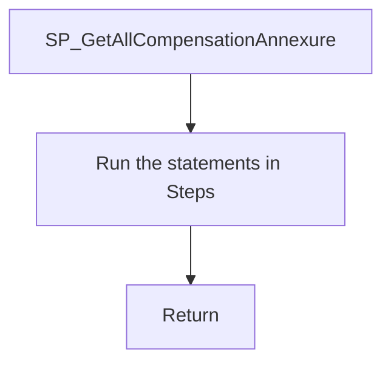

# SP_GetAllCompensationAnnexure

## What it does

Lists annexures for an employer with expanded component, BU, location, designation, and employment-type display names.

## Parameters

| Name | Direction | What it is for |
|---|---|---|
| `@employerId` | in | Employer |

## Call sequence

Calls no other procedures or functions.

## Callers

No other procedure or function calls this object.

## Nested

Calls no other procedures or functions.

## Steps

1. Resolve DefaultCompensationStructure id for the employer.
2. Select distinct annexure fields with STRING_AGG/STUFF expansions for components, BUs, locations, designations, and employment types.
3. Exclude Fixed/Variable/Total from the returned ComponentId list.

## Tables

| Table | Read or write |
|---|---|
| `dbo.CompensationAnnexure` | read |
| `dbo.TCompensationStructure` | read |
| `dbo.TEarningSalaryComponents` | read |
| `dbo.TOrgHierarchyDetails` | read |
| `dbo.TLocation` | read |
| `dbo.TTitle` | read |

## Flow

