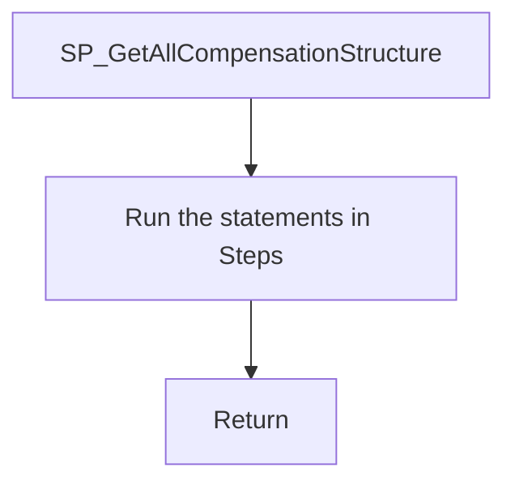

# SP_GetAllCompensationStructure

## What it does

Lists compensation structures for an employer with currency code and currency id from TCountry.

## Parameters

| Name | Direction | What it is for |
|---|---|---|
| `@employerId` | in | Employer whose structures are listed |

## Call sequence

Calls no other procedures or functions.

## Callers

No other procedure or function calls this object.

## Nested

Calls no other procedures or functions.

## Steps

1. Select CompensationStructureId, name, currency code, and currency id for TCompensationStructure rows with matching Employerid.

## Tables

| Table | Read or write |
|---|---|
| `dbo.TCompensationStructure` | read |
| `dbo.TCOUNTRY` | read |

## Flow

