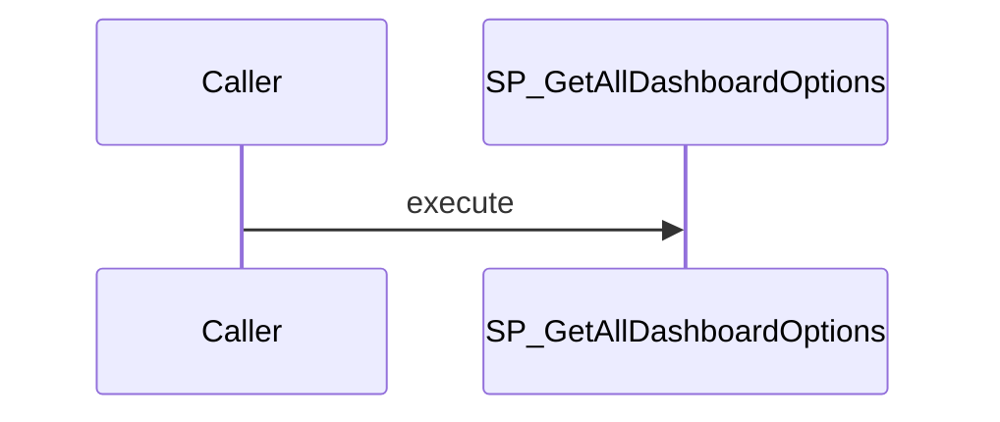
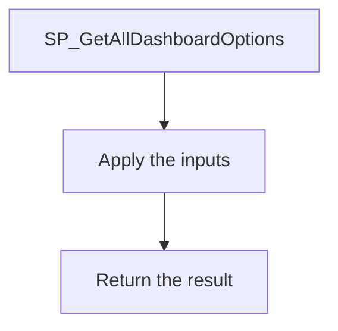

# SP_GetAllDashboardOptions

## What it does

Returns the enabled, non-deleted quick-link tiles for an employer. When the module argument is Dashboard it returns the dashboard set; otherwise it returns the other option set from the same table.

## Parameters

| Name | Direction | What it is for |
|---|---|---|
| `@EmployerId` | in | Employer that owns the data (`int`) |
| `@Module` | in | Which option set to return. The Quick Links card sends Dashboard (`varchar(100)`) |

## Call sequence

## Callers

No other procedure or function under STOREPROCEDURE or FUNCTIONS executes this object.

## Nested

This object does not execute another procedure or user-defined function.

## Steps

In `HRMS-DATABASE/HRMS/STOREPROCEDURE/SP_GetAllDashboardOptions.sql`:

1. Returns the enabled, non-deleted quick-link tiles for an employer.
2. When the module argument is Dashboard it returns the dashboard set; otherwise it returns the other option set from the same table.

## Tables

| Table | Read or write |
|---|---|
| `TDashboardOptions` | read |

## Flow

