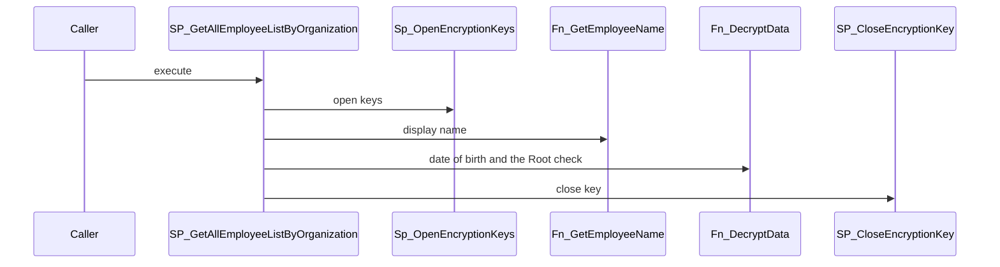
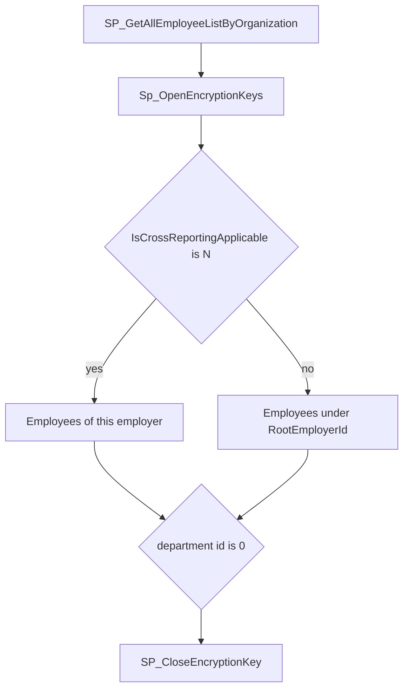

# SP_GetAllEmployeeListByOrganization

## What it does

Returns employees who can be picked for a new record, such as a business-unit head. When the employer does not allow cross reporting, the list is that employer. When it does, the list is every active or pending employee under the same `RootEmployerId`, and the name includes the employer name. A department id of 0 returns the wider list, including business unit and title. The `@active` parameter is not used. Names of `Root` are excluded.

## Parameters

| Name | Direction | What it is for |
|---|---|---|
| `@active` | in | Declared `VARCHAR(1)`, default `Y`. The statements do not read it |
| `@departmentID` | in | When 0, the list is not limited to one department. Otherwise `TEmployeeInfo.Department` must match. Default 0 |
| `@organizationId` | in | Employer used to read `IsCrossReportingApplicable` and, when cross reporting is off, to filter employees. Default 0 |

## Call sequence

## Callers

No other procedure or function calls this object. Create Organization Structure calls it through `CommonDAL.GetAllEmployeeListForEmployeeCreation`, passing only `organizationId`, when the business-unit head search box has no session cache.

## Nested

| Object | Kind | When | Page |
|---|---|---|---|
| `Sp_OpenEncryptionKeys` | procedure | start of the procedure | [Sp_OpenEncryptionKeys](/docs/database/hrms/Sp_OpenEncryptionKeys) |
| `Fn_GetEmployeeName` | function | every name column | [Fn_GetEmployeeName](/docs/database/hrms/Fn_GetEmployeeName) |
| `Fn_DecryptData` | function | date of birth, and first name when excluding `Root` | [Fn_DecryptData](/docs/database/hrms/Fn_DecryptData) |
| `SP_CloseEncryptionKey` | procedure | after the select | [SP_CloseEncryptionKey](/docs/database/hrms/SP_CloseEncryptionKey) |

## Steps

In `HRMS-DATABASE/HRMS/STOREPROCEDURE/SP_GetAllEmployeeListByOrganization.sql`:

1. Execute [Sp_OpenEncryptionKeys](/docs/database/hrms/Sp_OpenEncryptionKeys).
2. Read `IsCrossReportingApplicable` from `TemployerDetails` for `@organizationId`.
3. When that flag is `N` and `@departmentID` is 0, select active or pending employees of that employer. `Name` is the employee name plus employment number. `AssignedWorkTo` adds the unit name from `TOrgHierarchyDetails` and the title from `ttitle`. `DOB` is decrypted.
4. When the flag is `N` and a department is passed, select the same employees limited to that department. This branch has no `AssignedWorkTo` column.
5. When the flag is not `N`, read one `RootEmployerId` from `Temployeeinfo` for `@organizationId`.
6. With department 0, select active or pending employees whose `RootEmployerId` matches, and append the employer name to `Name`.
7. With a department, select that same root-employer set limited to the department.
8. Every branch excludes a decrypted first name of `Root` and orders by the display name.
9. Execute [SP_CloseEncryptionKey](/docs/database/hrms/SP_CloseEncryptionKey).

## Tables

| Table | Read or write |
|---|---|
| `dbo.TemployerDetails` | read |
| `dbo.TEmployee` | read |
| `dbo.TEmployeeInfo` | read |
| `dbo.TOrgHierarchyDetails` | read |
| `dbo.ttitle` | read |

## Flow

