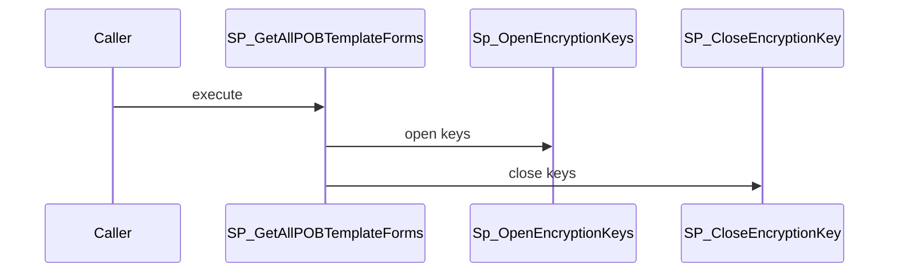
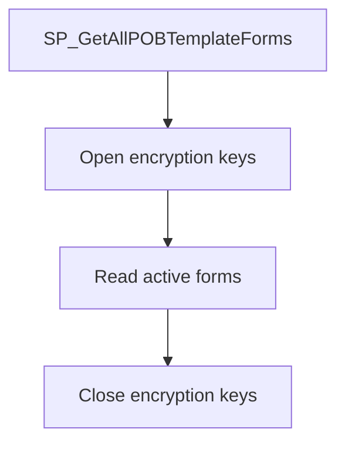

# SP_GetAllPOBTemplateForms

## What it does

Returns active template-form file rows for one employer and template, including the template country id. Opens and closes encryption keys around the select.

## Parameters

| Name | Direction | What it is for |
|---|---|---|
| `@Employerid` | in | Employer of the forms |
| `@TemplateId` | in | Template whose forms are listed |

## Call sequence

## Callers

No other procedure or function calls this object.

## Nested

| Object | Kind | When | Page |
|---|---|---|---|
| `Sp_OpenEncryptionKeys` | procedure | before the select | [Sp_OpenEncryptionKeys](/docs/database/hrms/Sp_OpenEncryptionKeys) |
| `SP_CloseEncryptionKey` | procedure | after the select | [SP_CloseEncryptionKey](/docs/database/hrms/SP_CloseEncryptionKey) |

## Steps

1. Execute `Sp_OpenEncryptionKeys`.
2. Select active `POBTemplateForms` rows for the employer and template, joined to `POBTemplate` for `CountryID`.
3. Execute `SP_CloseEncryptionKey`.

## Tables

| Table | Read or write |
|---|---|
| `POBTemplateForms` | read |
| `POBTemplate` | read |

## Flow

