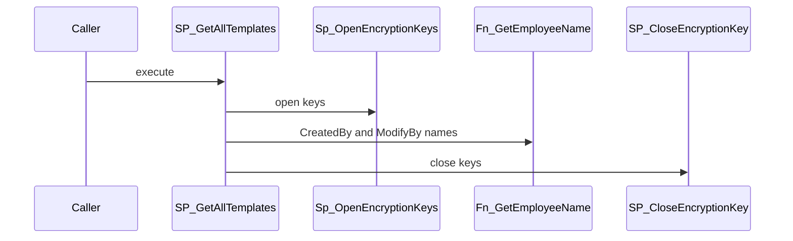
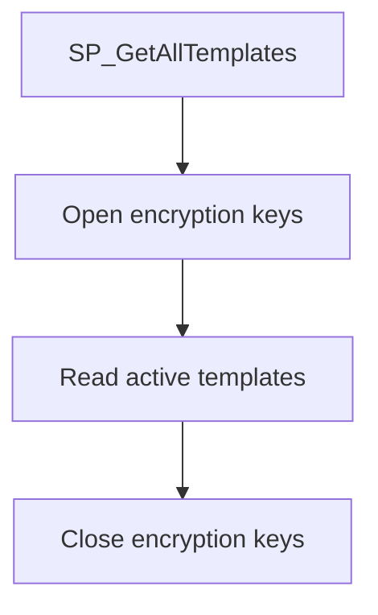

# SP_GetAllTemplates

## What it does

Returns active pre-onboarding templates for an employer, with creator and modifier names, category name, country, and a count of candidate assignments. Opens and closes encryption keys around the select.

## Parameters

| Name | Direction | What it is for |
|---|---|---|
| `@EmployerID` | in | Employer whose templates are listed |

## Call sequence

## Callers

No other procedure or function calls this object.

## Nested

| Object | Kind | When | Page |
|---|---|---|---|
| `Sp_OpenEncryptionKeys` | procedure | before the select | [Sp_OpenEncryptionKeys](/docs/database/hrms/Sp_OpenEncryptionKeys) |
| `Fn_GetEmployeeName` | function | for CreatedBy and ModifyBy | [Fn_GetEmployeeName](/docs/database/hrms/Fn_GetEmployeeName) |
| `SP_CloseEncryptionKey` | procedure | after the select | [SP_CloseEncryptionKey](/docs/database/hrms/SP_CloseEncryptionKey) |

## Steps

1. Execute `Sp_OpenEncryptionKeys`.
2. Select active `POBTemplate` rows for `@EmployerID` joined to `temployeedetail_category` where `SegmentID` is 3.
3. Include assignment counts from `POBCandidateTemplate` and display names from `Fn_GetEmployeeName`.
4. Execute `SP_CloseEncryptionKey`.

## Tables

| Table | Read or write |
|---|---|
| `POBTemplate` | read |
| `temployeedetail_category` | read |
| `POBCandidateTemplate` | read |

## Flow

