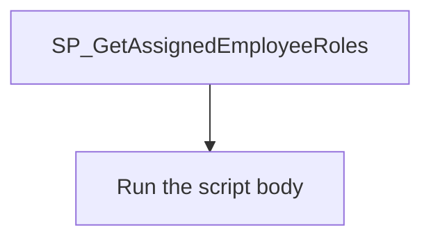

# SP_GetAssignedEmployeeRoles

## What it does

Lists employee roles that are assigned to at least one employee of the employer.

## Parameters

| Name | Direction | What it is for |
|---|---|---|
| `@Employerid` | in | Employerid |

## Call sequence

Calls no other procedures or functions.

## Callers

No other procedure or function calls this object.

## Nested

Calls no other procedures or functions.

## Steps

Script: `HRMS-DATABASE/HRMS/STOREPROCEDURE/SP_GetAssignedEmployeeRoles.sql`.

1. Select EmployeeRoleId,

## Tables

| Table | Read or write |
|---|---|
| `TEmployeeRoleMaster` | read |
| `TEmployeeInfo` | read |

## Flow

