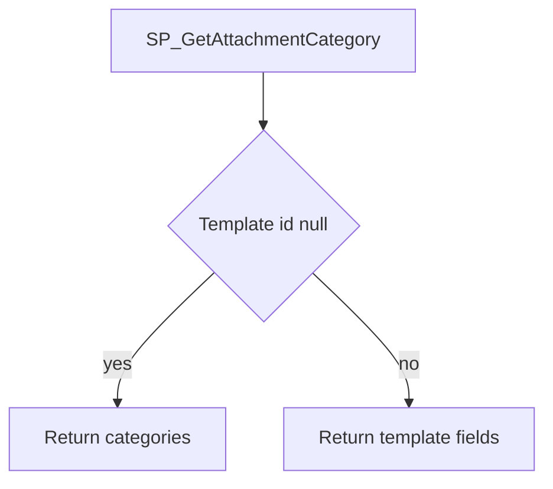

# SP_GetAttachmentCategory

## What it does

Returns attachment categories for an employer. When the template id is null, it lists TAttachmentCategory. This screen does not pass the document-builder filter, so every category for the employer is returned. A template id returns pre-onboarding template fields instead.

## Parameters

| Name | Direction | What it is for |
|---|---|---|
| `@Employerid` | in | Employer |
| `@Templateid` | in | Optional pre-onboarding template. Null lists categories |
| `@IsForDocumentBuilder` | in | When 1, keep categories marked for the document builder. Defaults to 0 |

## Call sequence

Calls no other procedures or functions.

## Callers

No other procedure or function calls this object.

## Nested

Calls no other procedures or functions.

## Steps

1. When `@Templateid` is null, select `TAttachmentCategory` for the employer (`SP_GetAttachmentCategory.sql`).
2. Apply `IsShowInDocumentBuilder` only when `@IsForDocumentBuilder` is 1.
3. Otherwise select pre-onboarding template fields for that template.

## Tables

| Table | Read or write |
|---|---|
| `dbo.TAttachmentCategory` | read |
| `dbo.POBTemplate` | read |
| `dbo.POBTemplateFields` | read |

## Flow

