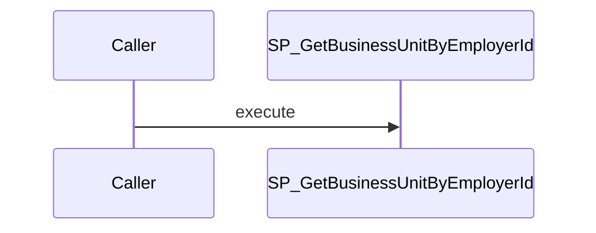
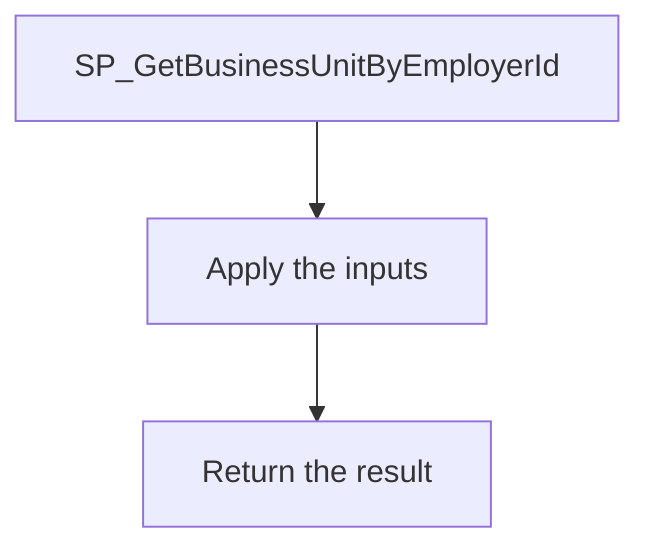

# SP_GetBusinessUnitByEmployerId

## What it does

Returns the employer's business-unit label from customer settings. Quick Links uses it as the caption on the organisation unit.

## Parameters

| Name | Direction | What it is for |
|---|---|---|
| `@EmployerId` | in | Employer that owns the data (`INT`) |

## Call sequence

## Callers

No other procedure or function under STOREPROCEDURE or FUNCTIONS executes this object.

## Nested

This object does not execute another procedure or user-defined function.

## Steps

In `HRMS-DATABASE/HRMS/STOREPROCEDURE/103658/SP_GetBusinessUnitByEmployerId.sql`:

1. Returns the employer's business-unit label from customer settings.
2. Quick Links uses it as the caption on the organisation unit.

## Tables

| Table | Read or write |
|---|---|
| `TCustomerSettings` | read |

## Flow

