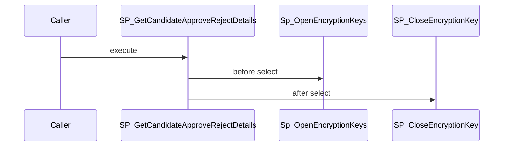
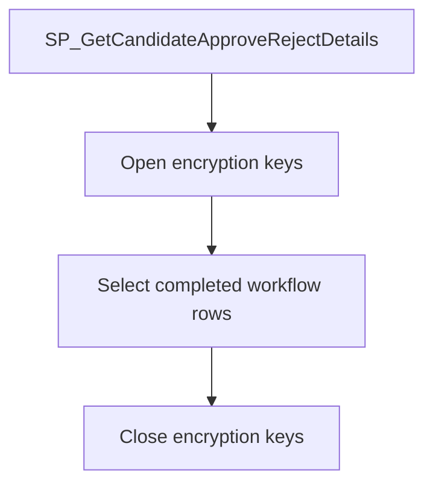

# SP_GetCandidateApproveRejectDetails

## What it does

Returns completed DirectCandidate approval/rejection history for a candidate: manager, comments, status, timestamps, and resolved employee/designation names. Filters `TRequestWorkflows` to `ApproveStatus` in (`C`,`R`) for the given workflow, where the manager is also the updater.

## Parameters

| Name | Direction | What it is for |
|---|---|---|
| `@EmployerId` | in | Candidate employer on `TMAddCandidate` |
| `@CandidateId` | in | Candidate id |
| `@WorkflowId` | in | Workflow to filter history |

## Call sequence

## Callers

No other procedure or function calls this object.

## Nested

| Object | Kind | When | Page |
|---|---|---|---|
| `Sp_OpenEncryptionKeys` | procedure | before the select | [Sp_OpenEncryptionKeys](/docs/database/hrms/Sp_OpenEncryptionKeys) |
| `SP_CloseEncryptionKey` | procedure | after the select | [SP_CloseEncryptionKey](/docs/database/hrms/SP_CloseEncryptionKey) |
| `Fn_GetEmployeeName` | function | manager display name | [Fn_GetEmployeeName](/docs/database/hrms/Fn_GetEmployeeName) |

## Steps

1. Open encryption keys.
2. Select from `TMAddCandidate` joined to `TRequestWorkflows` for completed decisions on `@WorkflowId`.
3. Resolve designation titles and manager names.
4. Close encryption keys.

## Tables

| Table | Read or write |
|---|---|
| `TMAddCandidate` | read |
| `TRequestWorkflows` | read |
| `TTitle` | read |
| `TEmployeeInfo` | read |

## Flow

