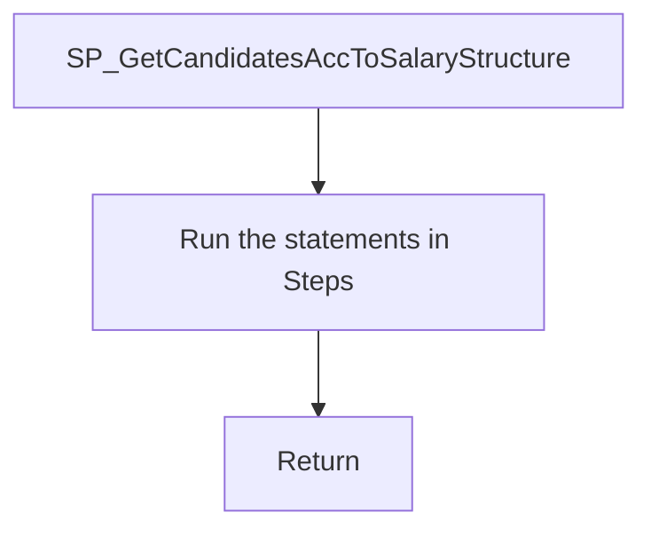

# SP_GetCandidatesAccToSalaryStructure

## What it does

Lists candidates linked to a salary annexure with concatenated name and candidate status.

## Parameters

| Name | Direction | What it is for |
|---|---|---|
| `@Employerid` | in | Declared but unused in the body |
| `@annexureId` | in | Annexure id |

## Call sequence

Calls no other procedures or functions.

## Callers

No other procedure or function calls this object.

## Nested

Calls no other procedures or functions.

## Steps

1. Select distinct annexure, candidate, concatenated name, and CandidateStatus from TAnnexureSalaryStructure joined to TRRSCandidate and TRRSCandidateMapping.
2. Filter by AnnexureId only.

## Tables

| Table | Read or write |
|---|---|
| `dbo.TAnnexureSalaryStructure` | read |
| `dbo.TRRSCandidate` | read |
| `dbo.TRRSCandidateMapping` | read |

## Flow

