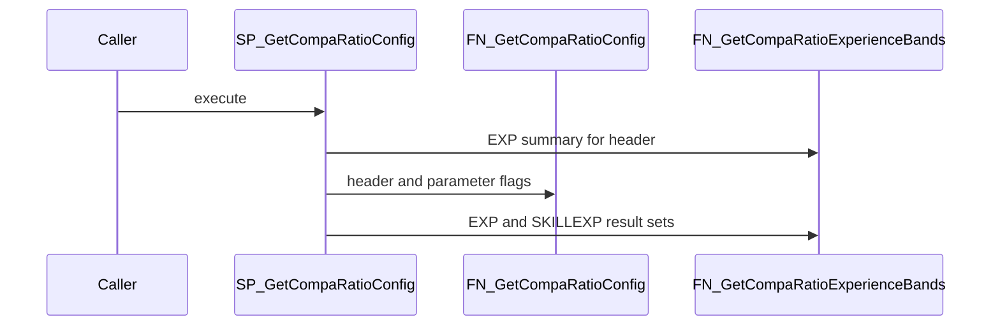
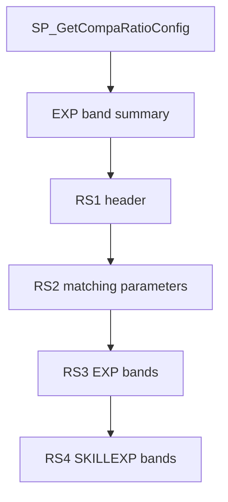

# SP_GetCompaRatioConfig

## What it does

Returns the Auto Compa-Ratio configuration for one employer as four result sets: header/settings, the nine matching parameters with toggle state, Experience Band rows, and Skill Experience Band rows. When the employer has never saved a config, nested helpers supply defaults (core parameters on, Min skills 2, seed band masters).

## Parameters

| Name | Direction | What it is for |
|---|---|---|
| `@EmployerId` | in | Organisation whose config is loaded |
| `@LoggedInEmployeeId` | in | Optional; accepted by the procedure signature but unused in the body |

## Call sequence

## Callers

Procedures and functions that call this object.

No other procedure or function calls this object. Node DAL `GetCompaRatioConfig` executes it for the Admin Configuration screen.

## Nested

| Object | Kind | When | Page |
|---|---|---|---|
| `FN_GetCompaRatioConfig` | function | header and matching-parameter flags | [FN_GetCompaRatioConfig](/docs/database/hrms/FN_GetCompaRatioConfig) |
| `FN_GetCompaRatioExperienceBands` | function | EXP summary and RS3/RS4 | [FN_GetCompaRatioExperienceBands](/docs/database/hrms/FN_GetCompaRatioExperienceBands) |

## Steps

1. Build an Experience Band summary string from `FN_GetCompaRatioExperienceBands(@EmployerId, 'EXP')` (`STOREPROCEDURE/SP_GetCompaRatioConfig.sql`).

2. RS1 — select header fields from `FN_GetCompaRatioConfig`, left join `TCompensationCompaRatioConfig` for ModifiedBy/ModifiedDate, and count active non-soft-deleted `TEmployee` rows for ApproxEmployeesInScope.

3. RS2 — cross join `TCompensationMatchingParameter` to the config function and map ParamCode to IsEnabled / status text / dependency notes.

4. RS3 — Experience bands via `FN_GetCompaRatioExperienceBands(..., 'EXP')`.

5. RS4 — Skill Experience bands via `FN_GetCompaRatioExperienceBands(..., 'SKILLEXP')`.

## Tables

| Table | Read or write |
|---|---|
| `TCompensationCompaRatioConfig` | read |
| `TCompensationMatchingParameter` | read |
| `TEmployee` | read |
| `TCompensationExperienceBand` | read via nested function |
| `TCompensationExperienceBandDefault` | read via nested function |

## Flow

