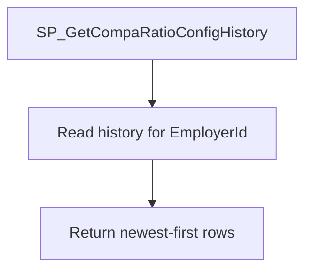

# SP_GetCompaRatioConfigHistory

## What it does

Returns Change History rows for an employer's Auto Compa-Ratio configuration, newest first. Formats ChangedOn as `dd-MMM-yyyy (HH:mm)` and marks the newest row with `IsNewest` for UI highlight and Excel/PDF export.

## Parameters

| Name | Direction | What it is for |
|---|---|---|
| `@EmployerId` | in | Organisation whose history is listed |
| `@Top` | in | Optional row limit; default returns all rows |

## Call sequence

Calls no other procedures or functions.

## Callers

Procedures and functions that call this object.

No other procedure or function calls this object. Node DAL `GetCompaRatioConfigHistory` executes it for the Admin Configuration Change History popover.

## Nested

Calls no other procedures or functions.

## Steps

1. Select from `TCompensationCompaRatioConfigHistory` for `@EmployerId`, ordered by `HistoryId` descending (`STOREPROCEDURE/SP_GetCompaRatioConfigHistory.sql`).

2. Project EmployeeName / EmployeeID from the stored name and employment-number snapshots, format ChangedOnText, and set IsNewest on the first row.

## Tables

| Table | Read or write |
|---|---|
| `TCompensationCompaRatioConfigHistory` | read |

## Flow

