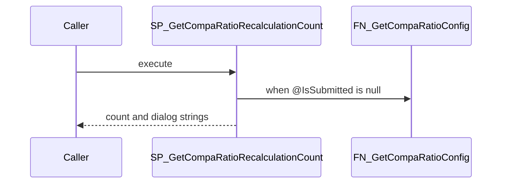
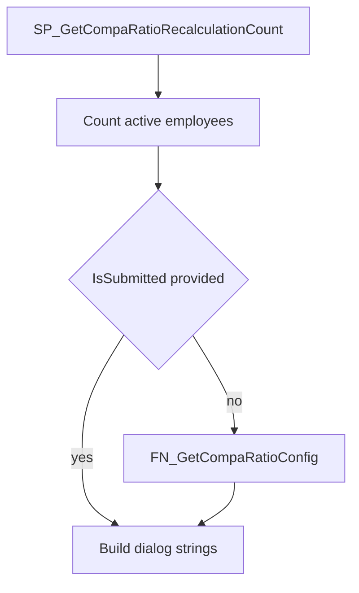

# SP_GetCompaRatioRecalculationCount

## What it does

Builds the confirm-dialog payload before Submit/Update. Counts active, not soft-deleted employees for the employer and returns dialog title, impact text with the formatted count, and reassurance that existing submitted compensation records are not rewritten.

## Parameters

| Name | Direction | What it is for |
|---|---|---|
| `@EmployerId` | in | Organisation whose active employees are counted |
| `@IsSubmitted` | in | Optional override; when null, read from `FN_GetCompaRatioConfig` |

## Call sequence

## Callers

Procedures and functions that call this object.

No other procedure or function calls this object. Node DAL `GetCompaRatioRecalculationCount` executes it before the Admin Configuration confirm dialog.

## Nested

| Object | Kind | When | Page |
|---|---|---|---|
| `FN_GetCompaRatioConfig` | function | when `@IsSubmitted` is null | [FN_GetCompaRatioConfig](/docs/database/hrms/FN_GetCompaRatioConfig) |

## Steps

1. Count `TEmployee` rows for `@EmployerId` with `IsActive = 'Y'` and soft-delete flag 0 (`STOREPROCEDURE/SP_GetCompaRatioRecalculationCount.sql`).

2. If `@IsSubmitted` is null, read `IsSubmitted` from `FN_GetCompaRatioConfig`.

3. Return ApproxEmployeeCount, DialogTitle (Submit vs Update), DialogImpactText, and DialogReassuranceText.

## Tables

| Table | Read or write |
|---|---|
| `TEmployee` | read |
| `TCompensationCompaRatioConfig` | read via nested function |

## Flow

