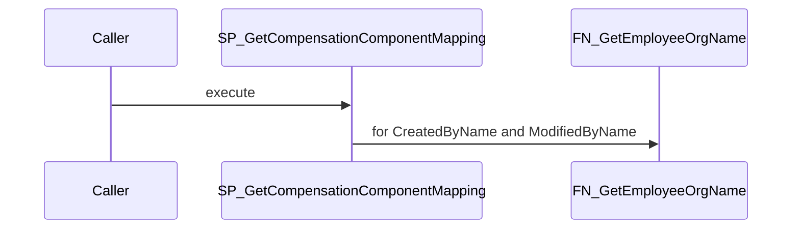
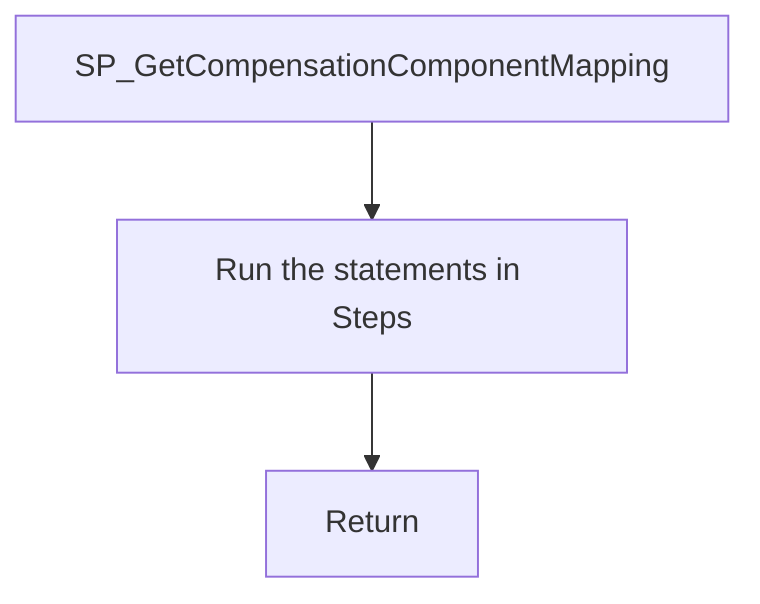

# SP_GetCompensationComponentMapping

## What it does

Lists payroll component mappings for an employer with created/modified display names. Cross-reporting flag is resolved via a TEmployee lookup that uses @EmployerId as employeeid.

## Parameters

| Name | Direction | What it is for |
|---|---|---|
| `@EmployerId` | in | Employer of the mapping rows; also misused as employee id for cross-reporting lookup |
| `@IsMapped` | in | Optional filter |

## Call sequence

## Callers

No other procedure or function calls this object.

## Nested

| Object | Kind | When | Page |
|---|---|---|---|
| `FN_GetEmployeeOrgName` | function | for CreatedByName and ModifiedByName | [FN_GetEmployeeOrgName](/docs/database/hrms/FN_GetEmployeeOrgName) |

## Steps

1. Read IsCrossReportingApplicable from TEmployerDetails via TEmployee where employeeid = @EmployerId.
2. Select mapping rows for EmployerId, optionally filtered by IsMapped.
3. Format CreatedByName and ModifiedByName with FN_GetEmployeeOrgName.
4. Order by MappingId descending.

## Tables

| Table | Read or write |
|---|---|
| `dbo.tCompensationComponentMapping` | read |
| `dbo.TEmployerDetails` | read |
| `dbo.TEmployee` | read |

## Flow

